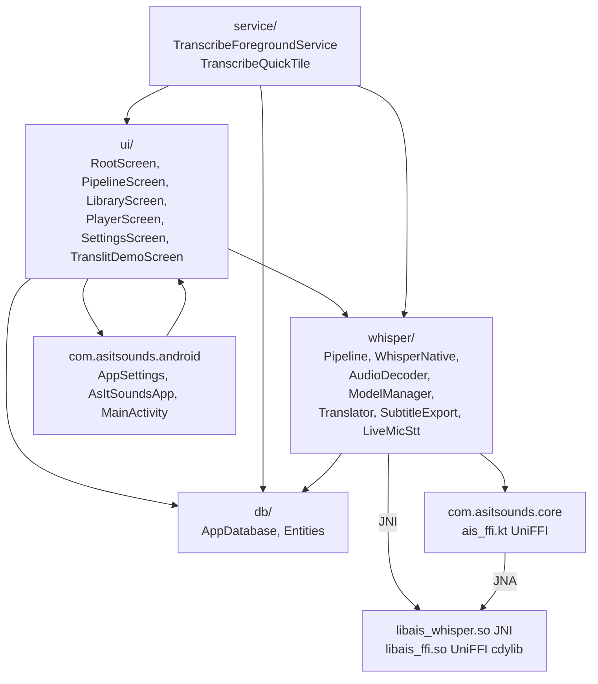
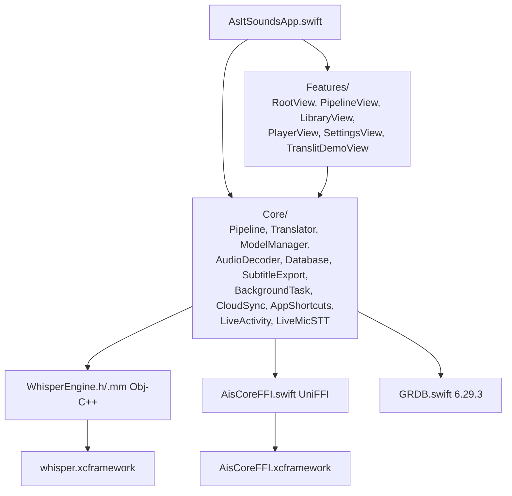
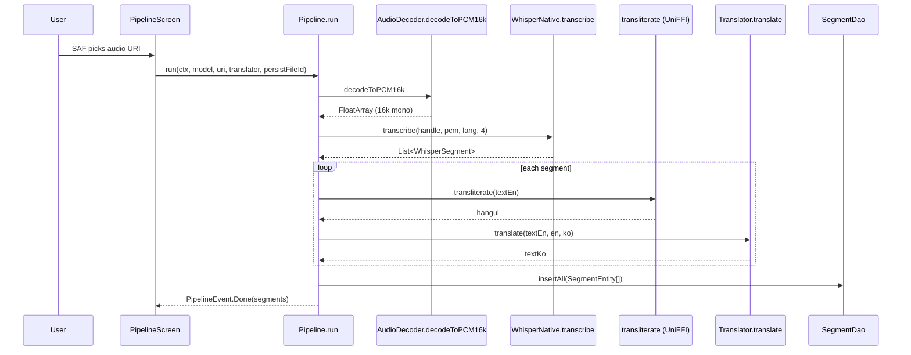
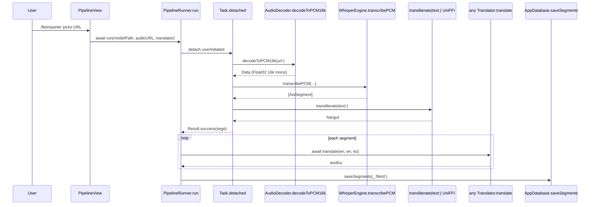

# 코드 단위 리뷰 보고서 / Line-by-Line Code Review

> 분석일 / Analysis Date: 2026-05-29
> 대상 / Target: `/Users/wise/Developer/Apps(Android,iOS,...)/As-It-Sounds-app`
> 리뷰 레벨 / Review Level: **2** — Default. ~3-year junior developer (handover-doc quality)
> 선택 파일 수 / Files Reviewed: **18** / **97** (소스 라인 후보, 생성 파일 제외)
> 분석 / Analyst: Claude (Anthropic)

---

## 1. 작업공간 인벤토리 / Workspace Inventory

### 1.1 디렉토리 트리 (depth 3) / Directory tree

```
As-It-Sounds-app/
├── .doc/                  # PRD, signing, store-metadata, kmm-migration, live-activity, ENV-setup
├── .github/workflows/     # ios.yml, android.yml, release.yml (수동 트리거)
├── .gitignore
├── README.md
├── assets/                # icon.svg / foreground.svg / generate-icons.sh / capture-screenshots.sh
├── core/                  # Rust 워크스페이스
│   ├── Cargo.toml
│   ├── crates/
│   │   ├── ais-translit/  # 데스크탑 translit.rs `#[path]` 재사용
│   │   └── ais-ffi/       # UniFFI 노출 (Swift + Kotlin)
│   ├── scripts/           # build-ios.sh, build-android.sh, assemble-whisper-xcframework.sh, generate-bindings.sh
│   ├── target/            # (gitignored) Rust 산출 + xcframeworks
│   ├── third_party/       # (gitignored) whisper.cpp v1.7.5
│   └── bindings/          # (gitignored) UniFFI 생성 Swift/Kotlin
├── android/
│   ├── build.gradle.kts
│   ├── settings.gradle.kts
│   ├── gradle/libs.versions.toml
│   └── app/
│       ├── build.gradle.kts
│       └── src/main/
│           ├── AndroidManifest.xml
│           ├── cpp/                 # CMakeLists.txt + ais_whisper_jni.cpp
│           └── java/com/asitsounds/
│               ├── android/         # 22 Kotlin 파일 (ui/, db/, service/, whisper/)
│               └── core/            # (생성) UniFFI Kotlin
└── ios/
    ├── project.yml                  # xcodegen spec
    ├── packages/GRDB/               # (gitignored) 로컬 SwiftPM clone
    └── AsItSounds/
        ├── AsItSoundsApp.swift
        ├── AsItSounds-Bridging-Header.h
        ├── Core/                    # 12 Swift + 1 Obj-C++
        ├── Features/                # 8 Swift
        └── Resources/               # Info.plist + Assets + en.lproj + ko.lproj
```

### 1.2 언어별 파일 수 / Files per language (확장자 기준)

| 확장자 | 개수 | 위치 |
| :-- | --: | :-- |
| `.kt` | 22 | `android/app/src/main/java/` |
| `.swift` | 20 | `ios/AsItSounds/{Core,Features}/` |
| `.rs` | 4 (workspace) + 1 (`#[path]` 외부) | `core/crates/*/src/` |
| `.cpp` | 1 | `android/app/src/main/cpp/` |
| `.h` / `.mm` | 1 / 1 | `ios/AsItSounds/Core/WhisperEngine.{h,mm}` |
| `.udl` | 1 | `core/crates/ais-ffi/src/ais_ffi.udl` |
| `.sh` | 4 | `core/scripts/` + `assets/` |
| `.toml` / `.yml` / `.kts` | 12 | manifests, version catalog, xcodegen |
| `.xml` | 7 | AndroidManifest + res/ |
| `.plist` | 1 | iOS Info.plist |
| `Localizable.strings` | 2 (en + ko) | `ios/AsItSounds/Resources/` |
| `strings.xml` | 2 (en + ko) | `android/app/src/main/res/values{,-ko}/` |
| `.md` | 11 | docs + READMEs + .review/ (이전 분석 산출) |

### 1.3 빌드·의존성 매니페스트 / Build & dependency manifests

| 파일 | 역할 |
| :-- | :-- |
| `core/Cargo.toml` | Rust 워크스페이스 (members: ais-translit, ais-ffi) |
| `core/crates/ais-translit/Cargo.toml` | Pure rlib, deps: `once_cell` |
| `core/crates/ais-ffi/Cargo.toml` | rlib + staticlib + cdylib, deps: `ais-translit` + `uniffi` |
| `core/Cargo.lock` | tracked, 재현성 보장 |
| `android/build.gradle.kts` (root) | plugin alias 만 |
| `android/settings.gradle.kts` | foojay toolchain + `:app` 포함 |
| `android/gradle/libs.versions.toml` | 14 의존 + 4 plugins 버전 카탈로그 |
| `android/app/build.gradle.kts` | AGP 8.13.2 + ABI splits + Compose + ndk + externalNativeBuild |
| `android/gradle/wrapper/gradle-wrapper.properties` | 8.10.2-bin |
| `ios/project.yml` | xcodegen spec + GRDB local package + 4 SDK frameworks + 2 xcframeworks |

### 1.4 락파일 / Lockfiles

| 파일 | 상태 |
| :-- | :-- |
| `core/Cargo.lock` | 존재 (tracked) |
| `android/` Gradle lock | **부재** — `dependencyLocking` 미설정 |
| `ios/` SwiftPM `Package.resolved` | xcodegen 산출물 (gitignored, 재생성 가능) |

### 1.5 진입점 후보 / Entry-point candidates

| # | 파일 | 진입 형태 |
| :-- | :-- | :-- |
| 1 | `android/app/src/main/java/com/asitsounds/android/MainActivity.kt` | `<activity android:name=".MainActivity">` Launcher intent |
| 2 | `android/app/src/main/java/com/asitsounds/android/service/TranscribeForegroundService.kt` | `ACTION_RUN` Intent (mediaProcessing FGS) |
| 3 | `android/app/src/main/java/com/asitsounds/android/service/TranscribeQuickTile.kt` | QS Tile bind |
| 4 | `ios/AsItSounds/AsItSoundsApp.swift` | `@main struct AsItSoundsApp: App` |
| 5 | `ios/AsItSounds/Core/AppShortcuts.swift` | `AppShortcutsProvider` (Siri / Shortcuts) |
| 6 | `ios/AsItSounds/Core/BackgroundTask.swift` | `BGTaskScheduler.register(...)` 등록 |
| 7 | `core/scripts/build-{ios,android}.sh` | 빌드 CLI |
| 8 | `core/scripts/assemble-whisper-xcframework.sh` | xcframework 조립 CLI |
| 9 | `core/crates/ais-ffi/src/bin/uniffi-bindgen.rs` | UniFFI CLI (feature `cli`) |

### 1.6 테스트 디렉토리·러너 / Test directories & runners

| 위치 | 상태 |
| :-- | :-- |
| `core/crates/ais-translit/src/lib.rs` `#[cfg(test)]` | 3 단위 테스트 작성 + 외부 `translit.rs` 의 30 테스트가 자동 inheritance |
| `android/app/src/test/` | **부재** |
| `android/app/src/androidTest/` | **부재** |
| `ios/AsItSoundsTests/` | **부재** |
| 의존성 선언 (JUnit 4 / AndroidX Test / Espresso) | `libs.versions.toml` 에 선언만, 미사용 |

---

## 2. 프로젝트 구조 / Project Structure

### 2.1 소스 트리 (depth 4, 역할 주석) / Source tree

```
.
├── core/                                       # Rust 비즈니스 로직 + UniFFI 다리
│   ├── Cargo.toml                              # 워크스페이스 (resolver 2)
│   ├── crates/
│   │   ├── ais-translit/                       # 데스크탑 translit.rs `#[path]` 재사용 rlib
│   │   │   ├── Cargo.toml
│   │   │   └── src/lib.rs                      # mod alias + 3 단위 테스트
│   │   └── ais-ffi/                            # UniFFI 노출 layer
│   │       ├── Cargo.toml                      # rlib+staticlib+cdylib + uniffi-bindgen bin
│   │       ├── build.rs                        # `uniffi::generate_scaffolding` 호출
│   │       ├── uniffi.toml                     # Swift/Kotlin codegen 설정
│   │       └── src/
│   │           ├── lib.rs                      # transliterate + version wrapper + scaffolding include
│   │           ├── ais_ffi.udl                 # 인터페이스 정의 (2 functions)
│   │           └── bin/uniffi-bindgen.rs       # CLI wrapper (feature gated)
│   └── scripts/
│       ├── build-ios.sh                        # iOS 3 target + lipo + xcframework
│       ├── build-android.sh                    # cargo-ndk 4 ABI + Kotlin bindings
│       ├── assemble-whisper-xcframework.sh     # iOS device+sim slice → xcframework
│       └── generate-bindings.sh                # 호스트 dylib + Swift/Kotlin smoke
│
├── android/
│   ├── build.gradle.kts                        # plugin alias 만
│   ├── settings.gradle.kts                     # foojay + :app
│   ├── gradle/libs.versions.toml               # 버전 카탈로그
│   └── app/
│       ├── build.gradle.kts                    # AGP 8.13.2 + Compose + Native + ABI splits
│       ├── proguard-rules.pro                  # JNA + UniFFI keep
│       └── src/main/
│           ├── AndroidManifest.xml             # 11 perms + 2 services + share intents
│           ├── cpp/
│           │   ├── CMakeLists.txt              # add_subdirectory(whisper.cpp)
│           │   └── ais_whisper_jni.cpp         # 4 JNI 함수
│           └── java/com/asitsounds/
│               ├── android/                    # 도메인 + UI (22 파일)
│               └── core/ais_ffi.kt             # (생성) UniFFI Kotlin
│
└── ios/
    ├── project.yml                             # xcodegen spec
    ├── packages/GRDB/                          # 로컬 SwiftPM (paren-path 회피)
    └── AsItSounds/
        ├── AsItSoundsApp.swift                 # @main scene root + BGTask register
        ├── AsItSounds-Bridging-Header.h        # #import "Core/WhisperEngine.h"
        ├── Core/                               # 12 Swift + 1 Obj-C++
        ├── Features/                           # 8 SwiftUI 화면
        └── Resources/                          # Info.plist + Assets + lproj
```

### 2.2 모듈·패키지 의존 그래프 / Module dependency graph

#### Rust 워크스페이스

```mermaid
graph LR
  AISFFI[ais-ffi cdylib+staticlib<br/>UniFFI scaffold]
  AISTL[ais-translit rlib<br/>#[path] desktop translit.rs]
  EXT[external desktop:<br/>NGL/.../src-tauri/src/core/translit.rs]
  UNIFFI[uniffi 0.28]
  ONCE[once_cell 1]

  AISFFI --> AISTL
  AISFFI --> UNIFFI
  AISTL --> EXT
  AISTL --> ONCE
```

#### Android (Kotlin 패키지)



#### iOS (Swift 모듈)



### 2.3 호출·응답 흐름도 / Call & response flow

#### Android — 사용자 파일 선택 → 결과



#### iOS — 동일 흐름 (Swift Concurrency)



### 2.4 외부 패키지 인벤토리 / Third-party package inventory

> 매니페스트 3개 (Rust workspace + Gradle catalog + xcodegen project.yml) 통합. `.bin` 모델은 런타임 다운로드 (앱 번들 미포함).

| 패키지 / Package | 버전 | 사용처 (파일·심볼) | 역할 | 라이선스 |
| :-- | :-- | :-- | :-- | :-- |
| `once_cell` | 1 | `crates/ais-translit/src/lib.rs` (transitive via desktop translit.rs `Lazy`) | Lazy 정적 초기화 | MIT/Apache-2.0 |
| `uniffi` | 0.28 | `crates/ais-ffi/src/lib.rs`, `build.rs`, `bin/uniffi-bindgen.rs` | Rust ↔ Swift/Kotlin FFI 코드 생성 | MPL-2.0 |
| `whisper.cpp` v1.7.5 | git submodule | `core/third_party/whisper.cpp/` (CMake/xcframework) | STT 추론 엔진 | MIT |
| `ggml` | bundled in whisper.cpp | 동상 | 텐서 백엔드 | MIT |
| **Android Gradle 의존성** | | | | |
| `com.android.application` | 8.13.2 | `app/build.gradle.kts` plugin | AGP | Apache-2.0 |
| `org.jetbrains.kotlin.android` | 2.0.21 | 동상 | Kotlin compiler | Apache-2.0 |
| `org.jetbrains.kotlin.plugin.compose` | 2.0.21 | 동상 | Compose compiler | Apache-2.0 |
| `com.google.devtools.ksp` | 2.0.21-1.0.27 | `libs.versions.toml` — **선언만, 미사용** | (Room 도입 시 활성 예정) | Apache-2.0 |
| `androidx.core:core-ktx` | 1.15.0 | (Android framework wide) | KTX 확장 | Apache-2.0 |
| `androidx.activity:activity-compose` | 1.9.3 | `MainActivity.kt` setContent | Compose activity | Apache-2.0 |
| `androidx.lifecycle:lifecycle-runtime-ktx` | 2.8.7 | (전역) | Lifecycle ktx | Apache-2.0 |
| `androidx.lifecycle:lifecycle-viewmodel-compose` | 2.8.7 | (선언만, 직접 사용 없음 — UiState 패턴은 plain SharedFlow) | ViewModel | Apache-2.0 |
| `androidx.compose:compose-bom` | 2024.12.01 | (전역) | Compose BOM | Apache-2.0 |
| `androidx.compose.ui:ui` (BOM) | — | `ui/*.kt` | Compose UI 핵심 | Apache-2.0 |
| `androidx.compose.ui:ui-graphics` | — | 동상 | Compose graphics | Apache-2.0 |
| `androidx.compose.ui:ui-tooling-preview` | — | `@Preview` annotations | Compose preview | Apache-2.0 |
| `androidx.compose.material3:material3` | — | 전체 화면 | Material 3 | Apache-2.0 |
| `androidx.compose.ui:ui-tooling` | — | debug only | Compose tooling | Apache-2.0 |
| `androidx.media3:media3-exoplayer` | 1.5.1 | `ui/PlayerScreen.kt` | ExoPlayer | Apache-2.0 |
| `androidx.media3:media3-ui` | 1.5.1 | 동상 | Media3 PlayerView | Apache-2.0 |
| `androidx.room:room-runtime/ktx/compiler` | 2.6.1 | **선언만, 미사용** (KSP 호환 이슈로 보류) | (Room 후보) | Apache-2.0 |
| `net.java.dev.jna:jna@aar` | 5.17.0 | UniFFI Kotlin bindings 런타임 | JVM ↔ native bridge | Apache-2.0 OR LGPL-2.1+ (이중) |
| `junit:junit` | 4.13.2 | (테스트, 사용처 없음) | 단위 테스트 | EPL-1.0 (테스트 only) |
| `androidx.test.ext:junit` | 1.2.1 | (테스트, 사용처 없음) | Android JUnit | Apache-2.0 |
| `androidx.test.espresso:espresso-core` | 3.6.1 | (테스트, 사용처 없음) | UI 자동화 | Apache-2.0 |
| `org.gradle.toolchains.foojay-resolver-convention` | 0.10.0 | `settings.gradle.kts` | JDK auto-resolver | Apache-2.0 |
| **iOS SwiftPM + xcframeworks** | | | | |
| GRDB.swift | 6.29.3 (local clone) | `Core/Database.swift` | SQLite ORM | MIT |
| `whisper.xcframework` (whisper.cpp v1.7.5) | static | `Core/WhisperEngine.mm` | STT | MIT |
| `AisCoreFFI.xcframework` (Rust ais-ffi) | static | `Core/AisCoreFFI.swift` | translit | MIT (앱) + MPL-2.0 (생성 파일) |
| `Accelerate.framework` | iOS SDK | whisper.cpp 자동 링크 | BLAS / cblas_sgemm | Apple SDK |
| `Metal.framework` / `MetalKit.framework` | iOS SDK | ggml-metal 백엔드 | GPU 가속 | Apple SDK |
| `CoreML.framework` | iOS SDK | whisper.coreml.a | Neural Engine 가속 | Apple SDK |

### 2.5 데이터 흐름·상태 저장소 / Data flow & state stores

#### 영구 저장소
- **SQLite (Android)**: `as-it-sounds.sqlite` — 테이블 `projects`, `media_files`, `segments` + 인덱스 `idx_media_project`, `idx_segments_file` (FK cascade).
- **SQLite (iOS)**: `Application Support/as-it-sounds.sqlite` (GRDB) — 동일 schema 3 테이블 (record 명: `Project`, `MediaFile`, `SegmentRecord`).
- **Whisper GGUF 모델**:
  - Android: `filesDir/models/ggml-<size>.bin`
  - iOS: `Application Support/models/ggml-<size>.bin` + `isExcludedFromBackup = true`.
- **사용자 설정**:
  - Android: `SharedPreferences("ais.settings")` — keys: `model`, `translator`, `colorScheme`.
  - iOS: `UserDefaults.standard` — keys: `ais.settings.model`, `.translator`, `.colorScheme`.

#### 인메모리 / 채널
- Android: `MutableSharedFlow<Unit>` (`AppDatabase.changeSignal`, replay=1) → DAO 변경 시 emit.
- iOS: `@Observable` macro 가 SwiftUI 갱신 신호.

#### 외부 I/O
- HTTP: `https://api.mymemory.translated.net/get`, `https://libretranslate.com/translate`, `https://api{,-free}.deepl.com/v2/translate`.
- HTTP: `https://huggingface.co/ggerganov/whisper.cpp/resolve/main/ggml-*.bin` (모델 다운로드).
- 파일: SAF `ActivityResultContracts.OpenDocument` (Android), `.fileImporter` (iOS).

#### 설정 소스
- 환경변수: `ANDROID_NDK_HOME` (build-android.sh) — 빌드 타임만.
- iOS Info.plist: 권한 문자열, `UIBackgroundModes`, `BGTaskSchedulerPermittedIdentifiers`.
- Android: `local.properties` (SDK 경로, gitignored).

### 2.6 진입점 목록 / Entrypoints

| # | 파일 | 심볼 | 호출 형태 |
| :-- | :-- | :-- | :-- |
| 1 | `android/app/src/main/java/com/asitsounds/android/MainActivity.kt` | `MainActivity.onCreate` | `<activity LAUNCHER>` + `SEND` / `SEND_MULTIPLE` intent filters |
| 2 | `android/app/src/main/java/com/asitsounds/android/AsItSoundsApp.kt` | `class AsItSoundsApp : Application` | `<application android:name=".AsItSoundsApp">` |
| 3 | `android/app/src/main/java/com/asitsounds/android/service/TranscribeForegroundService.kt` | `onStartCommand` | `Intent(ACTION_RUN)` (mediaProcessing FGS) |
| 4 | `android/app/src/main/java/com/asitsounds/android/service/TranscribeQuickTile.kt` | `onClick` | QS Tile bind |
| 5 | `ios/AsItSounds/AsItSoundsApp.swift` | `@main struct AsItSoundsApp` | SwiftUI scene |
| 6 | `ios/AsItSounds/Core/AppShortcuts.swift` | `AppShortcutsProvider.appShortcuts` | Siri / Shortcuts.app |
| 7 | `ios/AsItSounds/Core/BackgroundTask.swift` | `BackgroundTaskCoordinator.registerOnce` | `BGTaskScheduler.shared.register` |
| 8 | `core/scripts/build-ios.sh` | `bash` | 로컬 CLI |
| 9 | `core/scripts/build-android.sh` | `bash` | 로컬 CLI |
| 10 | `core/scripts/assemble-whisper-xcframework.sh` | `bash` | 로컬 CLI |
| 11 | `core/crates/ais-ffi/src/bin/uniffi-bindgen.rs` | `fn main` | `cargo run --features cli --bin uniffi-bindgen` |

---

## 3. 리뷰 파일 선정 / File selection

### 선택된 파일 (18 파일) / Selected files

| # | 경로 / Path | LOC | 선택 사유 / Reason |
| :-- | :-- | --: | :-- |
| 01 | [`core/Cargo.toml`](core/Cargo.toml.md) | 21 | 워크스페이스 정의 |
| 02 | [`core/crates/ais-translit/Cargo.toml`](core/crates/ais-translit/Cargo.toml.md) | 13 | 음차 rlib 메타 |
| 03 | [`core/crates/ais-translit/src/lib.rs`](core/crates/ais-translit/src/lib.rs.md) | 33 | 데스크탑 코어 재사용 진입 (핵심 IP) |
| 04 | [`core/crates/ais-ffi/Cargo.toml`](core/crates/ais-ffi/Cargo.toml.md) | 28 | UniFFI 레이어 메타 |
| 05 | [`core/crates/ais-ffi/src/ais_ffi.udl`](core/crates/ais-ffi/src/ais_ffi.udl.md) | 8 | FFI 계약 (Swift+Kotlin) |
| 06 | [`core/crates/ais-ffi/src/lib.rs`](core/crates/ais-ffi/src/lib.rs.md) | 11 | UniFFI scaffolding |
| 07 | [`core/scripts/build-ios.sh`](core/scripts/build-ios.sh.md) | 62 | iOS 빌드 파이프라인 |
| 08 | [`core/scripts/build-android.sh`](core/scripts/build-android.sh.md) | 54 | Android cargo-ndk 파이프라인 |
| 09 | [`android/app/build.gradle.kts`](android/app/build.gradle.kts.md) | 123 | AGP 빌드 설정 |
| 10 | [`android/app/src/main/cpp/CMakeLists.txt`](android/app/src/main/cpp/CMakeLists.txt.md) | 39 | whisper.cpp 정적 링크 |
| 11 | [`android/app/src/main/cpp/ais_whisper_jni.cpp`](android/app/src/main/cpp/ais_whisper_jni.cpp.md) | 132 | JNI 다리 (4 함수) |
| 12 | [`android/app/src/main/java/com/asitsounds/android/whisper/WhisperNative.kt`](android/app/src/main/java/com/asitsounds/android/whisper/WhisperNative.kt.md) | 51 | JNI 호출 Kotlin facade |
| 13 | [`android/app/src/main/java/com/asitsounds/android/whisper/Pipeline.kt`](android/app/src/main/java/com/asitsounds/android/whisper/Pipeline.kt.md) | 120 | 도메인 파이프라인 |
| 14 | [`android/app/src/main/java/com/asitsounds/android/whisper/ModelManager.kt`](android/app/src/main/java/com/asitsounds/android/whisper/ModelManager.kt.md) | 106 | 모델 다운로드 |
| 15 | [`android/app/src/main/java/com/asitsounds/android/whisper/AudioDecoder.kt`](android/app/src/main/java/com/asitsounds/android/whisper/AudioDecoder.kt.md) | 141 | MediaCodec → PCM |
| 16 | [`android/app/src/main/java/com/asitsounds/android/db/AppDatabase.kt`](android/app/src/main/java/com/asitsounds/android/db/AppDatabase.kt.md) | 214 | SQLiteOpenHelper + 3 DAO |
| 17 | [`android/app/src/main/java/com/asitsounds/android/service/TranscribeForegroundService.kt`](android/app/src/main/java/com/asitsounds/android/service/TranscribeForegroundService.kt.md) | 175 | mediaProcessing FGS |
| 18 | [`ios/AsItSounds/Core/WhisperEngine.mm`](ios/AsItSounds/Core/WhisperEngine.mm.md) | 105 | Obj-C++ whisper 래퍼 |

> Translator / Pipeline / ModelManager / AudioDecoder / Database 의 **iOS Swift 변형**은 Android Kotlin 변형과 흐름·계약이 동일 — 각 Kotlin 리뷰 안에서 "iOS counterpart" 섹션으로 차이만 짚는다. 중복 1:1 매핑 리뷰는 생략.

### 미선택 파일 / Deferred files

| 경로 | LOC | 제외 사유 |
| :-- | --: | :-- |
| `ios/AsItSounds/Core/Translator.swift` | 174 | Android `Translator.kt` 리뷰와 1:1 mirror — 차이만 cross-ref |
| `ios/AsItSounds/Core/Pipeline.swift` | 111 | Android Pipeline.kt 리뷰와 mirror |
| `ios/AsItSounds/Core/ModelManager.swift` | 122 | Android ModelManager 와 mirror, URLSession delegate 차이만 노트 |
| `ios/AsItSounds/Core/AudioDecoder.swift` | 140 | Android AudioDecoder 와 mirror, AVAssetReader 차이만 노트 |
| `ios/AsItSounds/Core/Database.swift` | 154 | Android AppDatabase 와 mirror, GRDB record/migrator 차이만 노트 |
| `ios/AsItSounds/Core/SubtitleExport.swift` | 55 | Android `SubtitleExport.kt` 와 동일 표 |
| `ios/AsItSounds/Core/CloudSync.swift` | 160 | iOS only, Phase 3 scaffold — Synthesis §4 에 risk 표기 |
| `ios/AsItSounds/Core/AppShortcuts.swift` | 60 | iOS only Phase 3 scaffold |
| `ios/AsItSounds/Core/LiveActivity.swift` | 72 | iOS only Phase 3 scaffold |
| `ios/AsItSounds/Core/LiveMicSTT.swift` | 140 | Phase 3, 코드 흐름은 LiveMicStt.kt 와 거의 동일 |
| `ios/AsItSounds/Core/BackgroundTask.swift` | 76 | Phase 1A scaffold, 큐 미연결 |
| `ios/AsItSounds/Features/PipelineView.swift` 외 7개 | ~640 | SwiftUI 화면 — Synthesis §1 idiom 노트만 |
| `android/app/src/main/java/com/asitsounds/android/ui/*` (10 Compose 화면) | ~700 | 화면 layer — Synthesis 에서 idiom + Material 3 사용 노트만 |
| `android/app/src/main/java/com/asitsounds/android/whisper/Translator.kt` | 164 | 표 §2.4 + Synthesis 에 정리 |
| `android/app/src/main/java/com/asitsounds/android/whisper/SubtitleExport.kt` | 67 | 표 §2.4 + Synthesis |
| `android/app/src/main/java/com/asitsounds/android/whisper/LiveMicStt.kt` | 143 | Phase 3 scaffold, 미실행 |
| `android/app/src/main/java/com/asitsounds/android/AppSettings.kt` | ~70 | 단순 SharedPreferences wrapper |
| `android/app/src/main/AndroidManifest.xml` | 71 | XML — risk 핫스팟만 §7.3 정리 |
| `ios/project.yml` | 87 | xcodegen spec — risk 만 §7.2 노트 |
| 5개 README + .doc/* | — | 이 리뷰는 코드 한정 |

---

## 4. 종합 분석 / Synthesis

### 4.1 반복 패턴 / Recurring patterns

1. **양 플랫폼이 Single Entry Pipeline**: `Pipeline.run(...) → Flow<PipelineEvent>` (Android) / `PipelineRunner.run(...) async` (iOS). 진입점이 하나라 라우팅·실패 처리 일관됨.
2. **모델 다운로드 = streaming + atomic rename**: 양 플랫폼 모두 `.part` 임시 파일 → 완료 시 rename. 부분 다운로드 손상 방지. iOS 는 `URLSession.background` 사용, Android 는 단순 HttpURLConnection.
3. **번역 4-impl SPI**: `Translator` 프로토콜/인터페이스 + `DisabledTranslator` / `MyMemoryTranslator` / `LibreTranslateTranslator` / `DeepLTranslator`. 양 플랫폼 동일 4 case. `make()` factory 로 enum → instance.
4. **네이티브 자원 RAII 누락**: Android `Pipeline.run` 은 `try/finally` 로 `WhisperNative.nativeFree(handle)` 호출 — OK. iOS `WhisperEngine.dealloc` 가 `whisper_free` — Swift 의 deinit 의존, fine. **위험**: iOS `LiveMicSTT` 의 `whisperEngine` 가 stop 시 명시적 해제 없음 — instance 가 살아있어 OK 지만, 컨텍스트 leak 가능 (Synthesis §3 hotspot).
5. **`@Observable` + `Task.detached` 패턴**: iOS 가 strict concurrency 위배 없이 non-Sendable Obj-C 객체를 가둠 (`WhisperEngine` 를 `Task.detached` 안에서 생성·사용·소멸). 권고 가능한 패턴.

### 4.2 계층 위반 / Layering violations

| 위반 | 설명 | 영향 |
| :-- | :-- | :-- |
| `Pipeline` 이 `AppDatabase.get(context)` 를 직접 호출 | DI 컨테이너 없이 singleton 사용 (Android) | 테스트에서 mock 주입 불가 |
| `TranscribeForegroundService` 가 `Pipeline.run` 직접 호출 + DB 업데이트 책임 분리 안됨 | Service 가 도메인 로직 + 영구화 + 알림 모두 담당 | SRP 위반, 향후 WorkManager 이관 시 리팩토링 필요 |
| iOS `Pipeline.swift` 의 `PipelineRunner` 가 `AppDatabase.shared.saveSegments` 직접 호출 | 동상 (싱글톤 의존) | 동상 |

> 의존 그래프 §2.2 의 의도(UI → 도메인 → 영구화·네이티브)는 대체로 지켜짐. DB 접근만 도메인 layer 안에서 singleton 으로 단축됨.

### 4.3 위험 핫스팟 / Risk hotspots (Top 5)

| # | 파일 | 위험 | 한 줄 사유 |
| :-- | :-- | :-- | :-- |
| 1 | `android/.../whisper/AudioDecoder.kt` | 메모리 폭증 | `ArrayList<Short>` 로 PCM 누적 — 30분+ 음원에서 OOM 위험 |
| 2 | `android/.../whisper/ModelManager.kt` | 무결성·재시도 | SHA256 검증 부재 + rename 실패 시 부분 cleanup 만 |
| 3 | `android/.../service/TranscribeForegroundService.kt` | 책임 과다 | 도메인 + DB + 알림 + State Holder + Lifecycle 동시 처리 |
| 4 | `ios/.../Core/WhisperEngine.mm` | unsafe pointer 캐스트 | `pcm.bytes` → `const float *` 직접 reinterpret, alignment 가정 (Float32 → byte buffer 내부 정렬 의존) |
| 5 | `core/scripts/build-ios.sh` | 경로 안전성 | `mv -f` 가 사전 존재 가정. `set -e` 와 결합 시 stale modulemap 잔존 시 silent overwrite |

### 4.4 삭제 후보 / Deletion candidates

| 위치 | 사유 |
| :-- | :-- |
| `android/.../ui/LibraryPlaceholderScreen.kt`, `SettingsPlaceholderScreen.kt` | Phase 0 placeholder. 실 구현 (`LibraryScreen`, `SettingsScreen`) 존재 — 호출처 없으면 dead |
| `ios/.../Features/LibraryPlaceholderView.swift`, `SettingsPlaceholderView.swift` | 동상 (실 구현으로 대체됨) |
| `core/Cargo.toml` 의 `[workspace.dependencies]` `uniffi` 항목 — 호출은 `crates/ais-ffi/Cargo.toml` 에서 직접 명시. 워크스페이스 공유 효과 없음 (1 crate 만 사용). | 약한 dead 신호 |
| `android/.../whisper/LiveMicStt.kt` | UI 미연결, 호출처 없음 (Phase 3 scaffold) |
| `ios/.../Core/{LiveActivity, AppShortcuts, CloudSync, LiveMicSTT, BackgroundTask}.swift` | Phase 3 scaffold, 일부 미와이어 |

### 4.5 테스트 공백 / Test gaps

| 모듈 | 커버리지 |
| :-- | :-- |
| Rust `ais-translit` | 3 단위 + 외부 30 fixture inheritance ✓ |
| Rust `ais-ffi` | 0 |
| Android Kotlin | 0 (테스트 dir 부재, deps 선언만) |
| iOS Swift | 0 (테스트 target 미선언) |
| JNI `ais_whisper_jni.cpp` | 0 (실행 시 smoke 만) |
| Build scripts | 0 (shell unit test 없음) |

→ 코드 변경 시 회귀 검증은 사실상 **Rust translit fixture 30 케이스 + 수동 디바이스 smoke** 두 갈래뿐.

### 4.6 다음 단계 / Next steps

1. **iOS `Pipeline.swift` + `Translator.swift` 짝맞춰 읽기** (이 리뷰의 cross-ref 만으로 충분치 않은 부분).
2. **Android `Translator.kt` 의 HTTP 안전성** (URL 인코딩, 응답 크기 한도) 보강.
3. **`AppDatabase` 양 플랫폼 동시 수정 시 schema 마이그레이션 필수 (현재 v1 only)** — Project 추가 컬럼 / FTS 추가 시 양쪽 동기 v2 작성.
4. **`AudioDecoder` 청크 처리 리팩토링** — 30분 이상 음원 OOM 위험.
5. **빌드 스크립트 idempotency 보강** — `mv` 에 `[[ -f ... ]]` 가드, `lipo` 산출 검증.

---

## 5. 부록 / Appendices

### A. 미선택 파일 목록 / Deferred files

§3 의 두 번째 표 참조.

### B. 외부 패키지 전체 목록 / Full package inventory

§2.4 참조 — 직접 의존성 22개 + iOS SDK 6개. transitive 는 별도 카운트 안함.

### C. 용어 사전 / Glossary (생략 — Level 2)

Level 2 에서는 생략. Level 0/1 보고서를 원하면 `--level 0` 또는 `--level 1` 재실행.

---

> Per-file reviews 는 위 §3 의 selected 표에서 각 행 링크 클릭.
