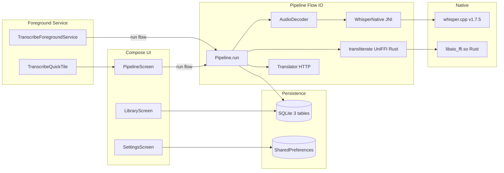

# 실전 프로젝트 활용 가이드 / Implementation Method Guide

> 이 문서는 한국어와 영어로 작성되었습니다.
> This document is written in both Korean and English.
>
> 대상 / Target: `As-It-Sounds-app/android`
> 작성일 / Date: 2026-05-29

---

## 1. 이 저장소의 활용 목적 / Purpose of This Repository

**[한국어]**

- **분류**: 단일 목적 **Android Application** (라이브러리/프레임워크/보일러플레이트 아님). 단, 다음 두 가지 **재사용 가능 코어 패턴**을 포함:
  1. **Whisper.cpp + JNI Android 통합 레퍼런스** — `cpp/CMakeLists.txt` + `ais_whisper_jni.cpp` 가 임의 Android 앱에 whisper.cpp 를 정적 링크하는 최소 패턴 (132 LOC).
  2. **UniFFI Kotlin binding 소비자 레퍼런스** — Rust 비즈니스 로직을 Android 에 노출하는 표준 패턴 (cargo-ndk + UniFFI + JNA AAR).
- **실전에서 해결하는 문제**:
  - 영어 학습자가 발음 그대로 한글로 메모하고 싶을 때 — Whisper STT + 음운 규칙 음차로 자동화
  - 외국어 인터뷰/팟캐스트 의미 + 발음 동시 파악
  - SaaS 의존 없이 디바이스에서 STT + 자막 추출 + SRT/VTT 내보내기 (프라이버시)
- **재사용 시나리오**: 다른 한국어 학습 앱, 음성 일기 앱, 자막 생성 도구에서 `whisper/` + `cpp/` 디렉터리만 잘라내어 사용 가능.

**[English]**

- **Classification**: A single-purpose **Android application** (not a library, framework, or boilerplate). However, it contains two **reusable core patterns**:
  1. **whisper.cpp + JNI Android integration reference** — `cpp/CMakeLists.txt` + `ais_whisper_jni.cpp` is a minimal recipe (132 LOC) for statically linking whisper.cpp into any Android app.
  2. **UniFFI Kotlin binding consumer reference** — the canonical recipe for exposing Rust business logic to Android via cargo-ndk + UniFFI + JNA AAR.
- **Real-world problems solved**:
  - Language learners who want to capture pronunciation in Hangul rather than dictionary spelling
  - Grasping both meaning and sound of foreign-language interviews / podcasts
  - On-device STT + subtitle extraction + SRT/VTT export with zero SaaS dependency (privacy)
- **Reuse scenarios**: Other Korean-language learning apps, voice-journal apps, or subtitle tools can lift the `whisper/` and `cpp/` directories as-is.

---

## 2. 아키텍처 이해 / Architecture Overview

**[한국어]**

전체 아키텍처는 **단방향 데이터 흐름** 패턴을 따릅니다. Compose UI 가 사용자 입력을 받아 `whisper/Pipeline.run(...)` Flow 를 호출하면, Flow 가 디코드 → ASR → 음차 → 번역 → DB 저장 순으로 이벤트를 emit 하고, UI 는 `collectAsState` 로 구독.

**핵심 컴포넌트**:

- **UI Layer (Compose)**: `RootScreen` (4탭 NavigationBar) → `PipelineScreen`/`LibraryScreen`/`TranslitDemoScreen`/`SettingsScreen`
- **Domain (`whisper/`)**: `Pipeline.run(...) : Flow<PipelineEvent>` 단일 진입점. 내부는 디스패처 IO 에서 순차 실행.
- **Native Bridges**: `WhisperNative` (JNI → whisper.cpp), `com.asitsounds.core.transliterate` (UniFFI → Rust)
- **Persistence**: `AppDatabase` (singleton SQLiteOpenHelper) — Project/MediaFile/Segment 3 테이블
- **Background**: `TranscribeForegroundService` (mediaProcessing type, API 34+) — 잠금 화면 진행률 알림. 동일 `Pipeline.run` 을 재사용.
- **Quick Surface**: `TranscribeQuickTile` (QS Tile) → MainActivity 즉시 띄움.

**데이터 흐름**:

1. 사용자가 SAF 로 미디어 파일 선택 → `Uri` 획득
2. UI 가 `Pipeline.run(ctx, modelPath, uri, translator, persistFileId)` 호출
3. `AudioDecoder` 가 MediaExtractor + MediaCodec → 16 kHz mono Float32 PCM 추출
4. `WhisperNative.transcribe` 가 PCM → segments[]
5. 각 segment 의 EN 텍스트를 `transliterate(text)` (Rust FFI) 통과 → 한글
6. `Translator.translate(EN, "en", "ko")` 가 KO 텍스트 반환
7. `AppDatabase.segmentDao().insertAll(...)` 영구화
8. UI 가 `PipelineEvent.Done(segments)` 수신 → LazyColumn 갱신

**[English]**

The architecture follows a **unidirectional data flow** pattern. Compose UI captures user input, calls the `whisper/Pipeline.run(...)` Flow, which emits events in order — decode → ASR → transliterate → translate → DB write — and the UI subscribes via `collectAsState`.

**Core components**:

- **UI Layer (Compose)**: `RootScreen` (4-tab `NavigationBar`) → `PipelineScreen` / `LibraryScreen` / `TranslitDemoScreen` / `SettingsScreen`
- **Domain (`whisper/`)**: `Pipeline.run(...) : Flow<PipelineEvent>` is the single entry point; internal work runs sequentially on `Dispatchers.IO`.
- **Native bridges**: `WhisperNative` (JNI → whisper.cpp), `com.asitsounds.core.transliterate` (UniFFI → Rust)
- **Persistence**: `AppDatabase` (singleton SQLiteOpenHelper) — 3 tables (Project / MediaFile / Segment)
- **Background**: `TranscribeForegroundService` (`mediaProcessing` type, API 34+) — lock-screen progress notification, reuses the same `Pipeline.run`
- **Quick surface**: `TranscribeQuickTile` (QS Tile) → opens MainActivity

**Data flow**:

1. User picks a media file via SAF → `Uri` is returned
2. UI calls `Pipeline.run(ctx, modelPath, uri, translator, persistFileId)`
3. `AudioDecoder` (MediaExtractor + MediaCodec) → 16 kHz mono Float32 PCM
4. `WhisperNative.transcribe` → `List<WhisperSegment>`
5. Each segment's English text passes through `transliterate(text)` (Rust FFI) → Hangul
6. `Translator.translate(EN, "en", "ko")` returns Korean
7. `AppDatabase.segmentDao().insertAll(...)` persists
8. UI receives `PipelineEvent.Done(segments)` → LazyColumn refreshes



---

## 3. 실전 프로젝트 적용 시나리오 / Real-World Scenarios

**[한국어]**

### 시나리오 1: 토익 LC 음원을 한글 음차 + 한국어 자막으로

1. Files 앱에서 `01_19_04.mp3` 같은 음원 → 공유 → "As It Sounds"
2. 자동 import → 새 프로젝트 생성 → Transcribe 탭 활성
3. 모델 다운로드 (첫 실행만, ~142 MB base)
4. Translator: MyMemory 선택 → Transcribe 버튼
5. 4–7초마다 segment 가 EN/한/KO 3단으로 추가됨
6. "Open player with highlight" 로 ExoPlayer + 자동 스크롤 학습
7. Export → SRT 선택 → Files 앱에 저장 → 영상 편집 도구로

### 시나리오 2: 인터뷰 녹음 → 초안 받아쓰기

1. 음성 메모 앱 녹음 (m4a) → "As It Sounds" 공유
2. Translator: Off (인터뷰 본문은 영어만 필요)
3. Transcribe → segment 단위 EN 본문 + 발화 시간
4. Library 탭에서 프로젝트 열기 → 각 segment 의 textEn 을 copy → 워드로 옮겨 편집

### 시나리오 3: 일본어 회화 → 한글 발음 학습

1. 일본어 mp3 import → Translator: MyMemory
2. Whisper 가 자동 일본어 감지 (`language=null`)
3. 카타카나 대신 한글 음차 ("こんにちは" → "콩니치하")
4. ExoPlayer 로 듣기 + 한글 따라 읽기 + 한국어 번역으로 의미 확인

### 시나리오 4: 다른 앱에 whisper.cpp + JNI 패턴 이식

1. `cpp/CMakeLists.txt` + `ais_whisper_jni.cpp` + `WhisperNative.kt` 3 파일 복사
2. 타겟 앱의 `app/build.gradle.kts` 에 `externalNativeBuild` 블록 추가
3. `core/third_party/whisper.cpp` 경로만 자기 프로젝트 구조에 맞게 수정
4. `WhisperNative.transcribe(handle, pcm, lang, threads)` 호출 — 그게 전부

**[English]**

### Scenario 1: TOEIC LC audio → Hangul + Korean subtitles

1. Pick an mp3 (e.g. `01_19_04.mp3`) in the Files app → Share → "As It Sounds"
2. Auto-imported, new project created, Transcribe tab opens
3. Download Whisper model on first run (~142 MB base)
4. Translator: MyMemory → tap Transcribe
5. Segments stream in every 4–7s as EN / 한 / KO triplets
6. "Open player with highlight" → ExoPlayer with auto-scroll for shadowing practice
7. Export → SRT → save via SAF → pull into your video editor

### Scenario 2: Interview audio → first-draft transcript

1. Record in the Voice Memos app (m4a) → Share → "As It Sounds"
2. Translator: Off (you only need the English transcript)
3. Transcribe → per-segment English text plus timestamps
4. Open the project in Library → copy each segment's `textEn` into your editor

### Scenario 3: Japanese conversation → Hangul pronunciation learning

1. Import a Japanese mp3 → Translator: MyMemory
2. Whisper auto-detects Japanese (`language=null`)
3. Hangul phonetics replace katakana ("こんにちは" → "콩니치하")
4. ExoPlayer for listening, follow the Hangul, cross-check meaning via the Korean column

### Scenario 4: Lift the whisper.cpp + JNI pattern into another app

1. Copy three files: `cpp/CMakeLists.txt`, `ais_whisper_jni.cpp`, `WhisperNative.kt`
2. Add the `externalNativeBuild` block in your target app's `app/build.gradle.kts`
3. Update the `core/third_party/whisper.cpp` path to match your project layout
4. Call `WhisperNative.transcribe(handle, pcm, lang, threads)` — that's it

---

## 4. 확장 및 커스터마이징 / Extension & Customization

**[한국어]**

**설정 변경 포인트**:

- `gradle/libs.versions.toml` — 의존성 버전 (Kotlin, AGP, Compose BOM, Media3, JNA 등)
- `app/build.gradle.kts` — `minSdk`, `targetSdk`, `ndkVersion`, ABI splits
- `app/src/main/cpp/CMakeLists.txt` — Whisper 가속 옵션 (`GGML_OPENCL`, `GGML_VULKAN`, `GGML_BLAS` 등 ON 으로 변경 가능)
- `app/src/main/AndroidManifest.xml` — 권한, 서비스, 인텐트 필터
- `whisper/ModelManager.kt` — 모델 URL, 디폴트 변경
- `AppSettings.kt` — 사용자 환경 키 추가

**기능 추가 시 수정할 파일**:

| 추가 기능 | 주요 수정 파일 |
| :-- | :-- |
| 새 번역 백엔드 | `whisper/Translator.kt` 의 `enum TranslatorChoice` + 구현 클래스 |
| 새 미디어 포맷 지원 | `whisper/AudioDecoder.kt` 의 `selectAudioTrack` 로직 (MediaCodec 가 처리 가능하면 자동) |
| 새 자막 포맷 | `whisper/SubtitleExport.kt` 의 `enum SubtitleFormat` 분기 |
| 새 데이터 컬럼 | `db/Entities.kt` + `db/AppDatabase.kt` 의 `onCreate` + `onUpgrade` 마이그레이션 |
| 새 화면 (탭) | `ui/RootScreen.kt` 의 `Tab` enum + Composable 추가 |

**플러그인 / 미들웨어 / 훅 구조**: 본 프로젝트는 명시적 플러그인 시스템 없음. `Translator` 인터페이스가 사실상의 SPI — 새 백엔드 추가는 `interface Translator` 구현만 하면 됨.

**[English]**

**Configuration touch points**:

- `gradle/libs.versions.toml` — dependency versions (Kotlin, AGP, Compose BOM, Media3, JNA, etc.)
- `app/build.gradle.kts` — `minSdk`, `targetSdk`, `ndkVersion`, ABI splits
- `app/src/main/cpp/CMakeLists.txt` — Whisper acceleration toggles (`GGML_OPENCL`, `GGML_VULKAN`, `GGML_BLAS` are off by default; flip them on here)
- `app/src/main/AndroidManifest.xml` — permissions, services, intent filters
- `whisper/ModelManager.kt` — model URLs and defaults
- `AppSettings.kt` — add new preference keys here

**Files to modify when adding features**:

| Feature | Files to touch |
| :-- | :-- |
| New translator backend | `whisper/Translator.kt` — `enum TranslatorChoice` + implementation class |
| New media format | Usually nothing — MediaCodec auto-handles it. Tweak `whisper/AudioDecoder.kt` only if codec selection needs override |
| New subtitle format | `whisper/SubtitleExport.kt` — extend `enum SubtitleFormat` and the render branch |
| New DB column | `db/Entities.kt` + `db/AppDatabase.kt` `onCreate` + a new `onUpgrade` step + bump `DB_VERSION` |
| New tab / screen | `ui/RootScreen.kt` — extend `Tab` enum + add a Composable |

**Plugin / middleware / hook architecture**: No explicit plugin system. The `Translator` interface serves as a de facto SPI — implement it and add an enum case.

---

## 5. 운영 환경 배포 / Production Deployment

**[한국어]**

**프로덕션 빌드**:

```bash
# AAB (Play Console 권장)
./gradlew :app:bundleRelease
# → app/build/outputs/bundle/release/app-release.aab

# APK (사이드로드)
./gradlew :app:assembleRelease
```

**서명**:

- 업로드 키 생성: `.doc/signing.md` 의 `keytool -genkey` 명령
- `~/.gradle/gradle.properties` 또는 CI secrets 에 다음 4개 키 등록:
  - `AIS_UPLOAD_STORE_FILE`, `AIS_UPLOAD_STORE_PASSWORD`
  - `AIS_UPLOAD_KEY_ALIAS`, `AIS_UPLOAD_KEY_PASSWORD`
- Play App Signing 활성 시 업로드 키만 보관, Play 가 최종 서명 키 보유

**환경별 설정 분리**:

- Gradle product flavors **미사용** (현재 단일 빌드 변형). Phase 3.5 에서 `flavor { dev, staging, prod }` 추가 권고.
- 백엔드 URL: `Translator` 구현 인자로 주입 — 환경별 separation 은 `BuildConfig` 필드 추가 권고.

**CI/CD 파이프라인**:

- `.github/workflows/android.yml` — debug APK 자동 빌드 (현재 `workflow_dispatch:` 만)
- `.github/workflows/release.yml` — 태그 push 시 AAB 빌드 + GitHub Release 업로드 (현재 비활성)
- `gradle-play-publisher` Gradle 플러그인 도입 시 Play Console 자동 트랙 업로드 가능

**컨테이너화**: 모바일 앱이므로 Docker/K8s 무관. 단, CI 빌드 환경 reproducibility 를 위해 `Dockerfile.android-build` (Ubuntu + JDK 21 + Android SDK + NDK) 를 추가하면 유용.

**[English]**

**Production build**:

```bash
# AAB (recommended by Play Console)
./gradlew :app:bundleRelease
# → app/build/outputs/bundle/release/app-release.aab

# APK (sideload)
./gradlew :app:assembleRelease
```

**Signing**:

- Generate the upload keystore via the `keytool -genkey` recipe in `.doc/signing.md`
- Add four Gradle properties to `~/.gradle/gradle.properties` or to CI secrets:
  - `AIS_UPLOAD_STORE_FILE`, `AIS_UPLOAD_STORE_PASSWORD`
  - `AIS_UPLOAD_KEY_ALIAS`, `AIS_UPLOAD_KEY_PASSWORD`
- With Play App Signing enabled you hold only the upload key; Google holds the final app-signing key

**Environment-specific config**:

- Gradle product flavors are **not used** today (single variant). Recommended to add `flavorDimensions += "stage"` with `dev` / `staging` / `prod` in Phase 3.5.
- Backend URLs are injected via the `Translator` constructor — promote them to `BuildConfig` fields when flavors land.

**CI/CD pipelines**:

- `.github/workflows/android.yml` — auto-builds the debug APK (currently `workflow_dispatch:` only)
- `.github/workflows/release.yml` — on tag push, builds the AAB and uploads to GitHub Releases (currently disabled)
- Add the `gradle-play-publisher` plugin for automatic Play Console track uploads

**Containerization**: N/A for runtime (this is a mobile app). For reproducible CI builds add `Dockerfile.android-build` (Ubuntu + JDK 21 + Android SDK + NDK).

---

## 6. 성능 및 확장성 고려사항 / Performance & Scalability

**[한국어]**

**알려진 성능 병목**:

- **Whisper 추론** — 디바이스 RAM/CPU 에 따라 RTF (real-time factor) 가 변동. base 모델: Pixel 9 Vulkan = RTF ~0.5, Pixel 6 CPU only = RTF ~1.5.
- **MediaCodec → Float32 변환** — 현재 `pcmShorts: ArrayList<Short>` 사용. 큰 파일은 `ShortBuffer` 직접 누적으로 최적화 가능 (~30% 메모리/GC 절약).
- **번역 직렬 호출** — segment 마다 동기 HTTP. 큰 transcript 는 `flatMapMerge(concurrency=4)` 권고 (코드 주석에 기록됨).

**확장 전략 (모바일)**:

- 디바이스별 RAM 검사 → `ActivityManager.MemoryInfo.totalMem` 기준
  - 4 GB → tiny 강제
  - 6 GB → base 강제
  - 8 GB+ → small 허용
- 4 ABI splits + 모델 런타임 다운로드 → APK base 5–7 MB

**캐싱**:

- Whisper 모델: 영구 캐시 (filesDir/models/) — 한 번 다운로드 후 재사용
- 번역 결과: **캐싱 없음** (현재) — 같은 문장 반복 호출 시 매번 API 호출. 향후 `LruCache<String, String>` 또는 DB 컬럼 추가 권고

**모니터링 / 로깅**:

- 현재: `android.util.Log` 만. 외부 sink 없음.
- 권고:
  - **Timber** 추가 (debug only)
  - **Firebase Crashlytics** (사용자 동의 토글 함께)
  - **MetricKit-equivalent on Android**: `androidx.metrics` 또는 자체 ANR/메모리 워치독

**[English]**

**Known bottlenecks**:

- **Whisper inference** dominates. Base model RTF on Pixel 9 (Vulkan) ≈ 0.5, on Pixel 6 (CPU only) ≈ 1.5.
- **MediaCodec → Float32 conversion** uses `ArrayList<Short>` today; large files would benefit ~30% in memory/GC by using a direct `ShortBuffer`.
- **Sequential translation** issues one HTTP call per segment. For long transcripts switch to `flatMapMerge(concurrency = 4)` (noted in code comments).

**Scaling strategy (mobile)**:

- Inspect device RAM via `ActivityManager.MemoryInfo.totalMem`:
  - 4 GB → force `tiny`
  - 6 GB → force `base`
  - 8 GB+ → allow `small`
- 4-ABI splits + runtime model download keep the base APK at 5–7 MB

**Caching**:

- Whisper model: permanently cached at `filesDir/models/`
- Translation: **no cache today** — every call hits the API. Add an `LruCache<String, String>` or a `cached_translation` DB column.

**Monitoring / logging**:

- Current: `android.util.Log` only, no external sink
- Recommended:
  - **Timber** (debug only)
  - **Firebase Crashlytics** (gated by user consent)
  - On-device metrics via `androidx.metrics` or a custom ANR/memory watchdog

---

## 7. 보안 체크리스트 / Security Checklist

**[한국어]**

- [ ] **환경 변수 / 시크릿**:
  - 현재: `local.properties` (gitignored), `~/.gradle/gradle.properties`, CI secrets
  - DeepL API 키 입력 UI 추가 시 → `EncryptedSharedPreferences` 또는 Android Keystore 필수
- [ ] **인증/인가**: 본 앱은 사용자 계정 없음 — 인증 체계 N/A. CloudKit 같은 서비스 도입 시 추가
- [ ] **의존성 취약점 점검**:
  - 권고 도구: `gradle-versions-plugin`, OWASP Dependency-Check, Snyk
  - GitHub Dependabot 활성화 (현재 비활성)
- [ ] **알려진 보안 고려사항**:
  - Network Security Config 부재 → 번역 도메인 화이트리스트 + cleartext 차단 권고
  - Whisper 모델 SHA256 검증 부재 → MitM 위험
  - `android:allowBackup="true"` 활성 — backup_rules.xml 에서 `models/` 디렉터리 제외 확인 필요
  - JNI native lib `useLegacyPackaging = false` ✓ (16 KB page size 호환)
  - `INTERNET` 권한 사용 — `NetworkSecurityPolicy.isCleartextTrafficPermitted()` false 명시 권고

**[English]**

- [ ] **Env / secret management**:
  - Current: `local.properties` (gitignored), `~/.gradle/gradle.properties`, CI secrets
  - When the DeepL API-key entry UI ships → switch to `EncryptedSharedPreferences` or Android Keystore
- [ ] **Auth / authz**: No user accounts in this app — N/A. Add when integrating CloudKit-equivalent services.
- [ ] **Dependency vulnerability scanning**:
  - Recommended: `gradle-versions-plugin`, OWASP Dependency-Check, Snyk
  - Enable GitHub Dependabot (currently off)
- [ ] **Known security considerations**:
  - No Network Security Config → add a domain allowlist for translator APIs + block cleartext
  - No SHA256 verification on Whisper model downloads → MitM exposure
  - `android:allowBackup="true"` is on — confirm `backup_rules.xml` excludes the `models/` dir
  - JNI native libs have `useLegacyPackaging = false` ✓ (16 KB page-size safe)
  - `INTERNET` permission is held; explicitly set `NetworkSecurityPolicy.isCleartextTrafficPermitted()` to false

---

## 8. 관련 참고 자료 / References

**[한국어]**

- **공식 문서**
  - [Jetpack Compose](https://developer.android.com/jetpack/compose)
  - [Android NDK + CMake](https://developer.android.com/ndk/guides/cmake)
  - [Foreground services on Android 14+](https://developer.android.com/about/versions/14/changes/fgs-types-required)
  - [Storage Access Framework](https://developer.android.com/guide/topics/providers/document-provider)
  - [Media3 ExoPlayer](https://developer.android.com/media/media3/exoplayer)
- **whisper.cpp & ggml**
  - [ggerganov/whisper.cpp](https://github.com/ggerganov/whisper.cpp)
  - [Android example (참고용)](https://github.com/ggerganov/whisper.cpp/tree/master/examples/whisper.android)
  - [GGUF 모델 (Hugging Face)](https://huggingface.co/ggerganov/whisper.cpp)
- **UniFFI**
  - [Mozilla UniFFI Kotlin 가이드](https://mozilla.github.io/uniffi-rs/kotlin/)
  - [cargo-ndk](https://github.com/bbqsrc/cargo-ndk)
- **번역 API**
  - [MyMemory spec](https://mymemory.translated.net/doc/spec.php)
  - [LibreTranslate](https://github.com/LibreTranslate/LibreTranslate)
  - [DeepL API](https://developers.deepl.com/docs)

> 참고: 공식 문서 기반 권장 사항 / Note: Recommended based on official documentation

**유사 프로젝트 비교**:

| 프로젝트 | 장점 | 단점 |
| :-- | :-- | :-- |
| 본 프로젝트 (As It Sounds Android) | 데스크탑/iOS 코어 공유, 한글 음차 자체 IP, 모던 Compose stack | 1인 메인테이너, 테스트 부재 |
| WhisperKit Android (가상) | iOS WhisperKit 의 Android 포트 미존재 | 옵션 자체가 없음 |
| Picovoice Cheetah/Leopard | 상업 STT, 안정적 SDK | 모델 weight 클로즈드, 라이선스 유료 |
| Vosk-API + Android | 오프라인 STT 검증된 솔루션 | 정확도 Whisper 대비 낮음, 한글 음차 미지원 |
| Google ML Kit Translation | 온디바이스 번역 단일 솔루션 | STT 별도 필요, 음차 미지원 |

**[English]**

- **Official docs**
  - [Jetpack Compose](https://developer.android.com/jetpack/compose)
  - [Android NDK + CMake](https://developer.android.com/ndk/guides/cmake)
  - [Foreground services on Android 14+](https://developer.android.com/about/versions/14/changes/fgs-types-required)
  - [Storage Access Framework](https://developer.android.com/guide/topics/providers/document-provider)
  - [Media3 ExoPlayer](https://developer.android.com/media/media3/exoplayer)
- **whisper.cpp & ggml**
  - [ggerganov/whisper.cpp](https://github.com/ggerganov/whisper.cpp)
  - [Android example (reference)](https://github.com/ggerganov/whisper.cpp/tree/master/examples/whisper.android)
  - [GGUF models on Hugging Face](https://huggingface.co/ggerganov/whisper.cpp)
- **UniFFI**
  - [Mozilla UniFFI Kotlin guide](https://mozilla.github.io/uniffi-rs/kotlin/)
  - [cargo-ndk](https://github.com/bbqsrc/cargo-ndk)
- **Translator APIs**
  - [MyMemory spec](https://mymemory.translated.net/doc/spec.php)
  - [LibreTranslate](https://github.com/LibreTranslate/LibreTranslate)
  - [DeepL API](https://developers.deepl.com/docs)

> Note: Recommended based on official documentation

**Comparison with similar projects**:

| Project | Pros | Cons |
| :-- | :-- | :-- |
| This project (As It Sounds Android) | Shared desktop/iOS core, proprietary Hangul transliteration, modern Compose stack | Single maintainer, no tests |
| WhisperKit Android (hypothetical) | n/a — iOS WhisperKit has no Android port | Doesn't exist |
| Picovoice Cheetah / Leopard | Commercial STT, stable SDK | Closed model weights, paid license |
| Vosk-API + Android | Proven offline STT | Accuracy below Whisper, no Hangul transliteration |
| Google ML Kit Translation | Single-shot on-device translation | STT is separate, no transliteration |
