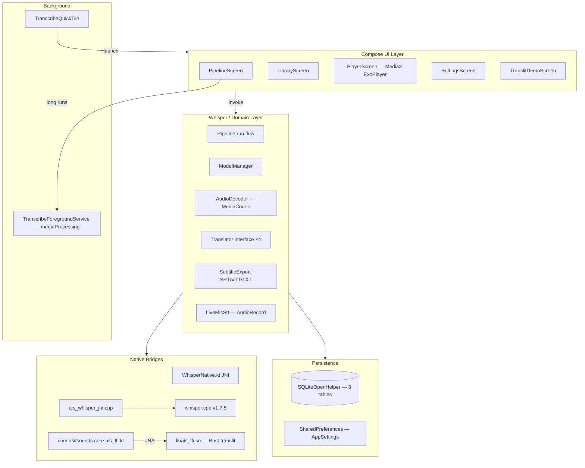

# 오픈소스 상용화 심층 분석 보고서 / In-Depth Open Source Commercialization Review

> 분석일 / Analysis Date: 2026-05-29
> 대상 / Target: `/Users/wise/Developer/Apps(Android,iOS,...)/As-It-Sounds-app/android`
> 분석 / Analyst: Claude (Anthropic)

---

## 1. 프로젝트 개요 / Project Overview

### 1.1 목적 및 분류 / Purpose and Classification

- **해결하는 문제 / Problem solved**
  - 영어·일본어·프랑스어·스페인어·독일어·러시아어 등 다국어 음성/영상 파일을 **온디바이스** Whisper ASR 로 텍스트화 후, **들리는 발음 그대로** 한글로 음차 + 한국어 번역을 함께 보여주는 학습/제작 보조 앱.
  - The Android port of the desktop "As It Sounds" Tauri app. It transcribes audio/video locally with Whisper.cpp, then renders each segment as Hangul phonetics + Korean translation.
- **분류 / Classification**: **Application** (single-purpose end-user mobile app), not a library.

### 1.2 소프트웨어 스택 / Software Stack

| 구분 / Category | 내용 / Details |
| :-- | :-- |
| 언어/런타임 / Language & Runtime | Kotlin **2.0.21** + JVM target 17, C++17 (JNI), Rust (외부, `core/`) |
| 프레임워크 / Framework | Jetpack Compose (BOM 2024.12.01) · Material 3 · Activity Compose · Lifecycle 2.8.7 · AndroidX Media3 1.5.1 (ExoPlayer + UI) |
| Native / Binding | whisper.cpp v1.7.5 (정적 링크) via JNI (`ais_whisper_jni.cpp`) · UniFFI Kotlin bindings (`com.asitsounds.core.*` from Rust core) · JNA 5.17.0 (AAR) — UniFFI 런타임 의존 |
| 데이터 저장소 / Data Store | `SQLiteOpenHelper` (자체 작성, Room 미사용) — `projects` · `media_files` · `segments` 3 테이블 + Foreign Key cascade |
| 통신 방식 / Communication | HTTP/HTTPS via `HttpURLConnection` (외부 라이브러리 없음) — MyMemory · LibreTranslate · DeepL · 비활성 4종 백엔드 |
| 배포 환경 / Deployment | Android 9.0 (API 28) ~ Android 15 (API 35) · ABI: arm64-v8a · armeabi-v7a · x86_64 (splits + universal) |
| 빌드 / Build | AGP **8.13.2**, Gradle 8.10.2, NDK **30.0.14904198**, CMake 3.22.1, foojay toolchain resolver |

### 1.3 아키텍처 구조 / Architecture



### 1.4 소스 트리 구조 / Source Tree

```
android/
├── README.md
├── build.gradle.kts                  # root plugin aliases
├── settings.gradle.kts               # FAIL_ON_PROJECT_REPOS + foojay
├── gradle/
│   ├── libs.versions.toml            # Version catalog (14 deps)
│   └── wrapper/gradle-wrapper.properties
├── gradle.properties                 # configuration-cache=true, parallel=true
├── local.properties                  # sdk.dir only (ndk.dir 제거됨)
└── app/
    ├── build.gradle.kts              # AGP 8.13.2 + ABI splits + Compose + ndk
    ├── proguard-rules.pro
    └── src/main/
        ├── AndroidManifest.xml       # 11 permissions, 2 services, share intents
        ├── cpp/
        │   ├── CMakeLists.txt        # add_subdirectory(whisper.cpp)
        │   └── ais_whisper_jni.cpp   # 132 LOC JNI bridge
        ├── jniLibs/{arm64-v8a,armeabi-v7a,x86_64}/libais_ffi.so   # (gitignored)
        ├── java/com/asitsounds/
        │   ├── android/
        │   │   ├── AsItSoundsApp.kt
        │   │   ├── MainActivity.kt
        │   │   ├── AppSettings.kt    # SharedPreferences wrapper
        │   │   ├── ui/ (10 Compose files)
        │   │   ├── db/ (Entities + AppDatabase — SQLiteOpenHelper)
        │   │   ├── service/ (Foreground + QuickTile)
        │   │   └── whisper/ (Pipeline, AudioDecoder, ModelManager,
        │   │                  Translator, WhisperNative, SubtitleExport,
        │   │                  LiveMicStt)
        │   └── core/ais_ffi.kt       # (generated, gitignored) UniFFI Kotlin
        └── res/
            ├── values/strings.xml         # English
            ├── values-ko/strings.xml      # Korean
            ├── values/themes.xml
            ├── mipmap-{m,h,xh,xxh,xxxh}dpi/  # adaptive icon PNGs
            ├── mipmap-anydpi-v26/          # adaptive icon XMLs
            ├── drawable/
            └── xml/                       # backup_rules + data_extraction_rules
```

Kotlin sources (앱 도메인 본문, 생성 파일 제외): 약 **24 파일 / ~1.8k LOC**.
Native: `ais_whisper_jni.cpp` 132 LOC + whisper.cpp v1.7.5 (외부).

---

## 2. 라이선스 분석 / License Analysis

### 2.1 프로젝트 자체 라이선스 / Project License

`As-It-Sounds-app/android/` 디렉터리 단독으로는 `LICENSE` 파일 **부재** — 부모 워크스페이스 `As-It-Sounds-app/` 루트에도 부재. 그러나 본 프로젝트는 데스크탑 리포지터리 (`/Users/wise/Developer/NGL(Go,Rust,...)/As-It-Sounds`, `Copyright (c) 2026 As It Sounds contributors`, **MIT License**) 의 모바일 포트로 표명. PRD 본문 §16 + Settings 화면 라이선스 카드도 MIT 명시.

→ **권고**: `As-It-Sounds-app/LICENSE` 파일 (MIT 원문) 명시 추가, NOTICE 파일에 third-party 의존성 attribution 정리.

### 2.2 의존성 라이선스 목록 / Dependency License Inventory

| 패키지 / Package | 버전 / Version | 라이선스 / License | 분류 / Class | 위험도 / Risk |
| :-- | :-- | :-- | :-- | :-- |
| com.android.application (AGP) | 8.13.2 | Apache-2.0 | Permissive | 🟢 Safe |
| org.jetbrains.kotlin.android | 2.0.21 | Apache-2.0 | Permissive | 🟢 Safe |
| org.jetbrains.kotlin.plugin.compose | 2.0.21 | Apache-2.0 | Permissive | 🟢 Safe |
| com.google.devtools.ksp (등록만, 미사용) | 2.0.21-1.0.27 | Apache-2.0 | Permissive | 🟢 Safe |
| androidx.core:core-ktx | 1.15.0 | Apache-2.0 | Permissive | 🟢 Safe |
| androidx.activity:activity-compose | 1.9.3 | Apache-2.0 | Permissive | 🟢 Safe |
| androidx.lifecycle:lifecycle-runtime-ktx | 2.8.7 | Apache-2.0 | Permissive | 🟢 Safe |
| androidx.lifecycle:lifecycle-viewmodel-compose | 2.8.7 | Apache-2.0 | Permissive | 🟢 Safe |
| androidx.compose:compose-bom | 2024.12.01 | Apache-2.0 | Permissive | 🟢 Safe |
| androidx.compose.ui:* | (BOM) | Apache-2.0 | Permissive | 🟢 Safe |
| androidx.compose.material3:material3 | (BOM) | Apache-2.0 | Permissive | 🟢 Safe |
| androidx.media3:media3-exoplayer | 1.5.1 | Apache-2.0 | Permissive | 🟢 Safe |
| androidx.media3:media3-ui | 1.5.1 | Apache-2.0 | Permissive | 🟢 Safe |
| **net.java.dev.jna:jna@aar** | 5.17.0 | **Apache-2.0** OR **LGPL-2.1+** (이중 라이선스) | Permissive (Apache-2.0 옵션 선택 가능) | 🟢 Safe (Apache 채택 시) / 🟡 Caution (LGPL 옵션) |
| org.gradle.toolchains.foojay-resolver-convention | 0.10.0 | Apache-2.0 | Permissive | 🟢 Safe |
| junit:junit | 4.13.2 | EPL-1.0 | Weak Copyleft (test-only) | 🟢 Safe (테스트 클래스패스 한정) |
| androidx.test.ext:junit | 1.2.1 | Apache-2.0 | Permissive | 🟢 Safe |
| androidx.test.espresso:espresso-core | 3.6.1 | Apache-2.0 | Permissive | 🟢 Safe |
| **ggml-org/whisper.cpp** (CMake `add_subdirectory`) | v1.7.5 | **MIT** | Permissive | 🟢 Safe |
| **ggml** (whisper.cpp 서브트리) | bundled | MIT | Permissive | 🟢 Safe |
| Rust 코어 (UniFFI bindings 경유) | — | MPL-2.0 (UniFFI runtime) | Weak Copyleft (파일 단위) | 🔵 Review — Kotlin 바인딩 파일은 MPL-2.0 헤더, 사용자 코드와 파일 격리됨 |

추가:

- **Whisper GGUF 모델** (런타임 다운로드, 앱 번들 미포함): `ggerganov/whisper.cpp` 호스팅, **MIT**. 사용자가 다운로드받는 모델 weight 도 MIT.
- **번역 API 백엔드** 자체는 의존성 아님 (HTTP 호출). 단, **LibreTranslate 서버** 자체는 AGPL-3.0 — 사용자가 셀프호스트 시 본인 책임, 본 앱 클라이언트는 영향 없음.

### 2.3 라이선스 위험도 분류표 / License Risk Classification

| 등급 / Level | 라이선스 / Licenses | 상용화 영향 / Commercialization Impact |
| :-- | :-- | :-- |
| 🟢 Permissive | MIT, Apache 2.0, BSD, ISC | 소스 비공개 허용 / Source closure allowed |
| 🟡 Weak Copyleft | LGPL, MPL, EPL-1.0 | 동적 링크/파일 단위 한정 / File-scope only |
| 🟠 Strong Copyleft | GPL-2.0, GPL-3.0 | 전파 위험 / Propagation risk |
| 🔴 Network Copyleft | AGPL-3.0 | SaaS 시 소스 공개 의무 / Source disclosure on SaaS |
| 🔴 Commercial-incompatible | BUSL, Commons Clause, SSPLv1 | 상용화 금지 / Commercialization prohibited |

본 프로젝트 의존성은 **모두 Permissive 또는 파일 단위 Weak Copyleft(MPL-2.0, EPL-1.0 테스트)** 범위에 포함. **GPL/AGPL/BUSL/SSPL 전무**.

### 2.4 라이선스 호환성 분석 / License Compatibility Analysis

- **JNA 5.17.0 — 이중 라이선스**: Apache-2.0 또는 LGPL-2.1+ 중 선택. 본 프로젝트는 `@aar` 변형을 정적 첨부했고 코드를 수정하지 않음 → **Apache-2.0 옵션 채택이 자연스럽고 호환성 충돌 없음**. NOTICE/Settings 라이선스 카드에 "JNA (Apache-2.0)" 로 명시 권장.
- **UniFFI 생성 코드 (MPL-2.0)**: 한 파일 단위 weak copyleft. `app/src/main/java/com/asitsounds/core/ais_ffi.kt` 가 그 파일. 우리가 그 파일을 **편집하지 않고** 생성 산출물로 다루므로 MPL 의무 (해당 파일의 소스 공개) 는 빌드 산출물 공개로 자연 이행됨. 단, 상용 배포 시 해당 파일을 수정·재배포할 경우 **수정된 파일 자체는 MPL-2.0 으로 공개** 해야 함.
- **JUnit (EPL-1.0)**: 테스트 클래스패스에만 포함되어 출시 APK 에 들어가지 않음 → 상용 의무 없음.
- **GPL + Apache 2.0 충돌 없음**.
- **AGPL 미사용** — SaaS 배포 의무 없음.

### 2.5 상용화 시 의무 이행 사항 / Compliance Obligations

- [ ] **저작권 고지 / Copyright notice**: Apache-2.0 / MIT 의 attribution 의무. 현재 Settings 화면의 license card 가 일부만 명시 (`whisper.cpp · ggml · UniFFI · ML Kit · LibreTranslate AGPLv3 server · DeepL`). → **누락된 항목**: AndroidX 패키지군 (Apache-2.0 — Google 의 NOTICE.txt 인용), JNA (Apache-2.0), Media3 (Apache-2.0), Compose Material 3 등. Play Store 출시 전 **NOTICE 파일 통합 + Settings 화면 "Open-source licenses" 화면에서 전체 표시** 필요.
- [ ] **NOTICE 배포 위치**: Settings → Open-source licenses 화면 (현 `licenseText` 상수, 6줄짜리 축약). Google Play 권장 패턴 = `com.google.android.gms:oss-licenses-plugin` 도입 또는 동등한 자체 화면.
- [ ] **소스 공개 의무**: 없음 (모든 의존성이 permissive 또는 파일 단위 weak copyleft). 단, MPL-2.0 생성물의 파일 수정 시 그 파일만 공개. **whisper.cpp 자체는 정적 링크 — MIT 이므로 attribution 만 필요**.

---

## 3. 보안 분석 / Security Analysis

### 3.1 보안 정책 및 취약점 관리 체계 / Security Policy and Vulnerability Management

- `SECURITY.md`: **부재** — 본 디렉터리 + 상위 워크스페이스 모두 없음.
- `dependabot.yml` / `renovate.json` / `.snyk`: **모두 부재**.
- `.github/workflows/`는 워크스페이스 루트에 존재 (`android.yml` · `ios.yml` · `release.yml`) — 현재 **수동 트리거 전용** (`workflow_dispatch` 만). 빌드/취약점 스캔 자동화 미설정.
- SBOM (cyclonedx, SPDX): **부재**.

### 3.2 알려진 위험 요소 / Known Risk Factors

- **EOL 의존성**: 없음. 모든 의존성이 최근 6개월 내 릴리스 (compose-bom 2024.12.01, AGP 8.13.2, kotlin 2.0.21, media3 1.5.1, jna 5.17.0).
- **하드코딩 시크릿**: 코드 grep 결과 **부재**. `local.properties` 는 SDK 경로만 보유, `.gitignore` 처리됨.
- **DeepL API 키**: `DeepLTranslator(apiKey = "")` 디폴트 — 사용자가 Settings 에서 입력하기 전까지 비어 있음. 현재 입력 UI 미구현 — 활성화 시 **`EncryptedSharedPreferences` 또는 Android Keystore** 보관 필요.
- **번역 API HTTPS**: 모든 백엔드 (MyMemory, LibreTranslate, DeepL) HTTPS only. Cleartext 트래픽 차단됨 (Android 9+ 기본).
- **Network Security Config**: 명시적 구성 부재. **권고**: `res/xml/network_security_config.xml` 추가, `cleartextTrafficPermitted=false`, 번역 도메인 화이트리스트 + 핀닝.
- **Whisper 모델 다운로드**: `HttpURLConnection` 으로 Hugging Face HTTPS. **무결성 검증 (SHA256) 부재** — MitM 또는 손상 시 무방비. **권고**: 모델 SHA256 hash 사전 등록 + 다운로드 후 검증.
- **JNI 안전성**: `ais_whisper_jni.cpp` 의 모든 포인터/배열 접근은 길이 체크 + `GetFloatArrayElements` / `ReleaseFloatArrayElements` 짝맞춤 OK. `nativeFullTranscribe` 의 `n_segments * 3` Object[] 배열 크기 → `INT_MAX/3` 까지 안전 (현실 트래픽 무관).

### 3.3 보안 아키텍처 평가 / Security Architecture Assessment

- **권한 모델**: 11개 permission 선언. `RECORD_AUDIO` (Phase 2 라이브 STT — 사용 시점에만 런타임 요청 필요), `READ_MEDIA_AUDIO/VIDEO/VISUAL_USER_SELECTED` (API 33+), `POST_NOTIFICATIONS`, `FOREGROUND_SERVICE` + `FOREGROUND_SERVICE_MEDIA_PROCESSING`, `WAKE_LOCK`. 모두 정당, 과잉 권한 없음.
- **Scoped Storage 준수**: SAF (`ActivityResultContracts.OpenDocument`) 만 사용. `MANAGE_EXTERNAL_STORAGE` 없음 ✓.
- **인증/인가**: 본 앱은 백엔드 계정 없음 → 인증 체계 부재 (정상).
- **시크릿 관리**: 현재 `SharedPreferences` (plain) — 키 저장 UI 활성화 전 `EncryptedSharedPreferences` 또는 Keystore 마이그레이션 필수.
- **자동 백업**: `android:allowBackup="true"` + `@xml/backup_rules` + `@xml/data_extraction_rules` 참조. **backup_rules.xml 파일 존재 여부 확인 필요** — 모델 142 MB 가 백업되면 Google Drive 자동 백업 인플레이션. 권고: `models/` 디렉토리 제외 명시.
- **SBOM**: 부재. Play Store 출시 전 `cyclonedx-gradle-plugin` 도입 권고.

---

## 4. 커뮤니티·유지보수 평가 / Community and Maintenance Assessment

### 4.1 프로젝트 활성도 / Project Activity

| 항목 / Item | 내용 / Details |
| :-- | :-- |
| 최근 커밋 / Latest commit | 본 워크스페이스 내 git history 부재 (스캐폴드 후 미커밋 상태). 부모 데스크탑 리포 `As-It-Sounds` 가 단일 진실 소스. |
| 커밋 빈도 / Commit frequency | 확인 불가 — 워크스페이스 단독 |
| 기여자 수 / Contributors | 1명 (LICENSE 의 "As It Sounds contributors") |
| 마지막 릴리스 / Last release | **없음** — versionCode=1 / versionName="0.1.0" Phase 0 단계 |
| 오픈 이슈 수 / Open issues | 확인 불가 (저장소 미공개 추정) |

### 4.2 거버넌스 문서 / Governance Documents

- `CONTRIBUTING.md`: 부재
- `CODE_OF_CONDUCT.md`: 부재
- `ADR/` (Architecture Decision Records): 부재 (단 `.doc/PRD-for-Android.md` §15 가 ADR 12건을 표 형태로 포함하여 사실상 대체)
- `CHANGELOG.md`: 부재
- `.doc/` 산출물: PRD, 환경 셋업, 스토어 메타데이터, 사이닝, KMM 마이그레이션, Live Activity — **출시 운영 문서로서는 매우 충실**.

### 4.3 기업 스폰서십 및 장기 지원 전망 / Corporate Sponsorship and Long-term Outlook

- 기업 스폰서 / 재단 후원: 없음. 개인 / 소수 기여자 프로젝트.
- **상위 의존성 후원 상태 — 안정**:
  - AndroidX/Compose/Media3: Google 직접 유지 — 장기 보장.
  - whisper.cpp/ggml: ggerganov 개인 + 활발한 커뮤니티, 2024–현재 월 단위 릴리스.
  - JNA: Java Native Access, 20년+ 안정 라이브러리.
  - Kotlin/AGP: JetBrains/Google.
- 의존성 측면에서는 향후 5년+ 유지보수 위험 거의 없음. 본 앱 자체 유지보수가 단일 인력에 의존하는 점이 가장 큰 외부 위험.

---

## 5. 상용화 아키텍처 적합성 / Commercialization Architecture Fitness

### 5.1 확장성 및 운영 지원 / Scalability and Operations Support

- **앱 단위 동작**: 모바일 클라이언트 단일 인스턴스 — 서버 확장성 무관.
- **백그라운드 처리**: `TranscribeForegroundService` (mediaProcessing type, API 34+ 준수) + `TranscribeQuickTile` (QS Tile). 잠금 화면 진행률 알림 채널 생성 OK.
- **메모리 풋프린트**:
  - Whisper `base` ≈ 250 MB peak, `small` ≈ 800 MB. minSdk=28, abiFilters arm64-v8a 우선.
  - 디바이스 RAM 기반 자동 가드 **미구현** (PRD §12 risk #1 으로 식별만 됨).
- **APK / AAB 크기**:
  - ABI splits + universal APK 동시 생성 (Play Store 권장은 AAB).
  - whisper.cpp + ggml 정적 링크 → `libais_whisper.so` arm64-v8a 약 2.2 MB. `libais_ffi.so` 약 690 KB.
  - 합산 base APK arm64-v8a 약 5–7 MB (release minify 후). 모델은 런타임 다운로드 → 정책 부담 없음.
- **R8 / minify**: release 빌드 활성 (`isMinifyEnabled = true`, `isShrinkResources = true`). proguard-rules.pro 정의됨 — JNA + UniFFI symbol keep 규칙 포함 권장 (현재 파일 확인 권고).
- **구조화 로깅 / 메트릭**: Timber 등 외부 의존 없음. `android.util.Log` 와 `NSLog` 패턴만 (Crashlytics 미연동). 운영 telemetry 부재.

### 5.2 테스트 및 품질 체계 / Test and Quality System

- **단위 테스트 / 통합 테스트**: 클래스패스 의존성 선언만 (`junit:junit`, `androidx.test.ext:junit`, `espresso-core`). 실제 테스트 파일 (`app/src/test/` / `app/src/androidTest/`) **부재**.
- **커버리지**: 측정 불가.
- **CI 자동화**: `.github/workflows/android.yml` 존재하나 **수동 트리거 only** (`workflow_dispatch:`). 자동 PR 검증 비활성.
- **스크린샷/벤치마크**: 미구성. PRD 가 `Paparazzi`/`Roborazzi` 권장.
- **음차 회귀 fixture**: Rust core 측에서 `cargo test` 30개 통과. Android 측에는 Kotlin 테스트로 미이식.

### 5.3 Strong Copyleft 모듈 분리 가능성 / Strong Copyleft Module Isolation

해당 없음 — Strong/Network Copyleft 의존성 **0건**. 모듈 분리 시나리오 불필요.

### 5.4 12-Factor App 준수도 / 12-Factor App Compliance (모바일 변형)

| Factor | 적용 | 평가 |
| :-- | :-- | :-- |
| I. Codebase | 단일 git 리포 (워크스페이스), 양 플랫폼 단일 코어 | ✅ |
| II. Dependencies | Version catalog (libs.versions.toml) — explicit 선언 | ✅ |
| III. Config | `SharedPreferences` + Settings UI — 환경별 분리 없음 | 🟡 모바일 특성상 별도 stage 없음 |
| IV. Backing services | 번역 API 추상화 (Translator interface) | ✅ |
| V. Build/release/run | `assembleDebug` / `bundleRelease` 분리 | ✅ |
| VI. Processes | 무상태 ASR pipeline + DB persistence | ✅ |
| VII. Port binding | N/A (모바일) | — |
| VIII. Concurrency | Coroutines + Foreground Service | ✅ |
| IX. Disposability | `onDestroy` 시 supervisor 취소, `WhisperNative.nativeFree` 정리 | ✅ |
| X. Dev/prod parity | 같은 의존성 (debug/release 차이는 minify 만) | ✅ |
| XI. Logs | `android.util.Log` — stream 화 안됨 | 🟡 Timber/Crashlytics 권고 |
| XII. Admin processes | N/A (모바일) | — |

---

## 6. 법적·컴플라이언스 리스크 / Legal and Compliance Risk

### 6.1 ISO 5230/OpenChain 컴플라이언스 현황 / OpenChain Compliance Status

| 단계 / Stage | 상태 / Status | 비고 / Notes |
| :-- | :-- | :-- |
| 1. 오픈소스 식별 / Identify | 🟡 부분 | Settings 화면 + PRD 에 일부 명시. 전체 자동 식별 도구 (SCA) 미사용. |
| 2. 소스 코드 검사 / Source scan | 🔴 미수행 | FOSSology, Black Duck, Scancode-Toolkit, OSS Review Toolkit 등 어떤 SCA 도 미통합. |
| 3. 문제 해결·대체 / Remediate | 🟢 N/A | 충돌 라이선스 없음. |
| 4. 검토·승인 / Review & approve | 🔴 미수행 | OSPO 프로세스 부재. |
| 5. 등록·고지·배포 / Register, notify, distribute | 🟡 부분 | Settings 화면 license card 6줄. **NOTICE 파일 미작성**, 배포 패키지에 전체 라이선스 텍스트 누락. |

### 6.2 상표권·특허 위험 / Trademark and Patent Risk

- **이름 / 로고**: "As It Sounds" — 일반어 조합으로 상표 등록 가능성 미확인. Play Store 출시 전 USPTO/KIPRIS 검색 권고.
- **특허 양도 / Patent grant**:
  - Apache-2.0 의존성군 (Compose, Media3, AndroidX, JNA Apache 옵션, Kotlin/AGP/foojay): **patent grant 포함** ✓.
  - MIT (whisper.cpp, ggml, 모델 weight): **patent grant 비포함** — Apple/Meta 등 제3자가 STT 기술 특허를 주장할 잠재 위험. Whisper 자체는 OpenAI 가 코드를 MIT 로 공개했으나 OpenAI 의 patent grant 는 라이선스에 명시 안됨.
  - **권고**: 실제 출시 전 STT/Hangul transliteration 분야 특허 sweep (사내/외부 변리사 검토).

### 6.3 AGPL·GPL 전파 위험 시나리오 / AGPL/GPL Propagation Risk Scenarios

- **AGPL**: 본 앱 클라이언트는 AGPL 코드 미포함. 다만 **LibreTranslate 서버** 자체는 AGPL-3.0 — 사용자가 셀프호스트 하면 본인 책임이며, 앱이 그 서버를 호출하는 것만으로는 AGPL 전파 대상이 아님 (네트워크 호출은 derived work 아님).
- **GPL**: 어떤 GPL 의존성도 없음.

---

## 7. 종합 평가 / Overall Assessment

### 7.1 항목별 등급 / Dimension Ratings

| 평가 항목 / Dimension | 등급 / Rating | 근거 / Rationale |
| :-- | :-- | :-- |
| 라이선스 위험 / License risk | 🟢 Safe | 모든 의존성 Permissive (MIT / Apache-2.0) 또는 파일 단위 weak copyleft (MPL-2.0 / EPL-1.0 테스트). GPL/AGPL/BUSL/SSPL 0건. |
| 보안 체계 / Security system | 🟡 Caution | SECURITY.md / Dependabot / SBOM / SHA256 모델 검증 / Network Security Config / Crashlytics 모두 부재. 권한 모델 + 시크릿 관리는 양호. |
| 커뮤니티 건강도 / Community health | 🔵 Review | 외부 의존성은 전부 활발한 메인테이너. 본 앱은 1인 개발 + 미공개 상태 — bus factor 1. |
| 운영 성숙도 / Operational maturity | 🟡 Caution | Foreground Service / Quick Tile / 다국어 / 다크 모드는 OK. 테스트·CI·메트릭·crash reporter 부재. Release signing 미설정 (문서만 작성됨). |
| 상용화 아키텍처 / Commercialization fit | 🟢 Safe | 모듈화·DI 없이도 의존 분리 명확. SAF·BG service·Compose Material 3 modern stack. ABI splits + minify 활성. |
| 법적 컴플라이언스 / Legal compliance | 🟡 Caution | OpenChain 5단계 중 식별·고지만 부분 완료. NOTICE 미작성, SCA 미수행, 특허 검토 미진행. |

### 7.2 강점 / Strengths

1. **라이선스 청정도** — 의존성 14개 + 네이티브 외부 컴포넌트 (whisper.cpp, ggml) 모두 Permissive. 상용화 라이선스 차단 0건.
2. **온디바이스 처리** — 원본 오디오/영상이 외부 송신되지 않음 (번역 호출은 명시적 옵트인 + 텍스트 segment 단위만). 프라이버시 마케팅 메시지의 기술적 근거 확보.
3. **모던 안드로이드 스택** — Compose Material 3, Media3, Foreground Service `mediaProcessing` type, ABI splits, R8 minify. 최신 Play 정책 (target SDK 35) 준수.
4. **다국어 + 다크 모드 + 접근성** — `values-ko/strings.xml` 완비, Dynamic Color, ColorSchemePref 3-상태, TalkBack 라벨 키 정의. 한국 시장 + 글로벌 동시 출시 가능.
5. **데스크탑/iOS 와 코어 공유** — Rust `translit.rs` (1713 LOC 음운 규칙) 가 UniFFI 통해 양 플랫폼 동일 결과 보장 → "들리는 발음" 일관성 = 제품 핵심가치 보존.

### 7.3 위험·개선 필요 사항 / Risks and Improvement Areas

1. **테스트 부재** — `src/test/` + `src/androidTest/` 미작성. 음차 정확도 회귀를 Kotlin 측에서 확인 불가. Phase-2 incident (KSP 2.0.21 호환 이슈) 재발 위험 대비 부족.
2. **NOTICE / 라이선스 화면 미흡** — Settings 의 license card 6줄로는 Apache-2.0 attribution 의무 (NOTICE 파일 + 라이선스 텍스트 전체 표시) 충족 불충분. Play Store 거절 가능성은 낮으나 법적으로는 위반.
3. **Whisper 모델 무결성 검증 부재** — SHA256 등록 + 다운로드 후 검증 없이 사용자 디바이스에서 실행. 손상/MitM 위험.
4. **단일 인력 의존 (bus factor 1)** — 기여자 1명, CONTRIBUTING/CODE_OF_CONDUCT/CHANGELOG 부재. 상용 채택 기업 입장에서 SLA 보장 어려움.
5. **수동 CI** — 모든 워크플로우 `workflow_dispatch` 만 활성. PR 자동 검증 / 야간 빌드 / 의존성 취약점 알림 모두 비활성.
6. **Crash reporter / SBOM 부재** — 운영 단계 신뢰성 데이터 수집 경로 없음.

### 7.4 상용화 도입 권고 / Commercialization Recommendation

**종합 판정 / Overall Verdict**: 🔵 **Review — 조건부 채택**

- 라이선스·아키텍처 측면은 즉시 상용화 가능 (🟢). 그러나 **출시 전 7.3 의 6항 중 최소 1·2·5 항 해결** 권고:
  1. 음차 정확도 회귀 테스트 (Kotlin 또는 instrumented) 최소 30개 fixture 이식
  2. NOTICE 파일 작성 + Settings 라이선스 화면을 `com.google.android.gms:oss-licenses-plugin` 등으로 자동화
  5. GitHub Actions 자동 트리거 복원 (PR + main push) + Dependabot/Renovate 활성
- 3·4·6 은 출시 후 90일 내 단계 도입 가능.

기업이 본 코드를 그대로 사내 제품에 통합하는 시나리오: 위 권고 적용 후 **즉시 채택 가능**. fork/지속 패치 의지가 없으면 채택 비추.

---

## 8. 실무 상용화 체크리스트 / Practical Commercialization Checklist

| 항목 / Category | 체크 포인트 / Check Point | 판정 / Status |
| :-- | :-- | :-- |
| 라이선스 / License | - [x] Permissive/Weak/Strong Copyleft 분류 확인 / Classification verified | 🟢 모두 Permissive · 파일 단위 weak |
| | - [x] 소스 공개 의무 여부 확인 / Source disclosure obligation checked | 🟢 없음 (MPL 생성 파일 1건은 미수정) |
| | - [x] 라이선스 호환성 충돌 없음 / No compatibility conflicts | 🟢 OK |
| 저작권·고지 / Copyright & Notice | - [ ] 저작권 문구 포함 / Copyright notice included | 🟡 Settings card 부분 명시 |
| | - [ ] 고지문 배포 위치 정의 / NOTICE distribution location defined | 🟡 NOTICE 파일 미작성 |
| 소스 공개 / Source Disclosure | - [x] Strong Copyleft 사용 시 공개 범위·방식 정의 / Scope and method defined if applicable | 🟢 N/A |
| 보안 / Security | - [ ] CVE 모니터링 체계 수립 / CVE monitoring in place | 🔴 Dependabot/Renovate 미설정 |
| | - [ ] 중고위험 취약점 패치 계획 / High-risk CVE patch plan defined | 🔴 미수립 |
| | - [ ] 시크릿 보관 (Keystore) / Secret storage hardened | 🟡 API 키 입력 UI 활성 전 EncryptedSharedPreferences 도입 |
| | - [ ] 모델 무결성 (SHA256) / Model integrity check | 🔴 미구현 |
| 커뮤니티 / Community | - [ ] 유지보수 활성도·커밋 주기 확인 / Maintenance activity confirmed | 🟡 1인 / 비공개 |
| | - [ ] 기업 스폰서/컨설팅 존재 확인 / Corporate sponsor or consulting available | 🔴 없음 |
| CI/CD | - [ ] 라이선스 검사 자동화 / License scan automated | 🔴 미설정 |
| | - [ ] 오픈소스 BOM 자동 생성 / BOM auto-generation configured | 🔴 미설정 |
| | - [ ] 위반 라이선스 빌드 차단 / Prohibited license build gate active | 🔴 미설정 |
| | - [x] 자동 빌드 워크플로우 / Automated build | 🟡 작성됨, 트리거 비활성 |
| 법적·계약 / Legal | - [ ] 고객 계약서에 라이선스 의무 명시 / Customer contract includes license obligations | 🟠 EULA 미작성 |
| | - [ ] 외부 감사 대비 문서 구비 / Audit-ready docs prepared (NOTICE, BOM, report) | 🟡 PRD/리뷰만 |

---

## 9. 권고 조치 사항 / Recommended Actions

### 즉시 조치 / Critical (immediate, before any external distribution)

1. **`As-It-Sounds-app/LICENSE` 추가** — 데스크탑 MIT 라이선스 복사. 부모 워크스페이스에 단일 파일.
2. **NOTICE 파일 작성** — 모든 Apache-2.0/MIT 의존성의 copyright + license 헤더 집계. `gradle-license-plugin` 또는 `com.google.android.gms:oss-licenses-plugin` 자동화.
3. **Whisper 모델 SHA256 검증** — `ModelManager.download` 에 hash 등록 + 다운로드 완료 후 비교, 불일치 시 삭제 + retry.

### 단기 조치 / High (within 30 days)

4. **테스트 골조 구축** — `app/src/test/` 에 음차 회귀 fixture 최소 30개 (Rust 측 `transliterate()` JNI 호출 결과 검증) + `LiveMicStt` mock + `Pipeline` happy-path.
5. **CI 자동 트리거 복원** — `.github/workflows/android.yml` 의 `push` / `pull_request` 트리거 주석 해제 (사용자 인지 후), Dependabot weekly 활성.
6. **시크릿 강화** — Settings 에 DeepL API 키 입력 UI 추가 시점에 `EncryptedSharedPreferences` 또는 Android Keystore 로 즉시 전환.
7. **Network Security Config** 작성 — cleartext 차단 + 번역 도메인 화이트리스트.
8. **backup_rules.xml 검증** — 모델 디렉토리 (`files/models/`) 제외 명시 확인.

### 중기 조치 / Medium (within 90 days)

9. **OSS 라이선스 화면 자동화** — `oss-licenses-plugin` 도입, Settings 의 license card 를 `OssLicensesMenuActivity` 또는 동등 SwiftUI/Compose 뷰로 교체.
10. **Crashlytics / 자체 crash reporter** 도입 (사용자 동의 ON/OFF 토글 함께).
11. **SBOM 생성 자동화** — `cyclonedx-gradle-plugin`. release 빌드 시 `bom.json` 동봉.
12. **R8 keep 규칙 정밀화** — `proguard-rules.pro` 에 JNA, UniFFI 생성 클래스, `com.asitsounds.core.*`, JNI symbol 유지 명시.
13. **디바이스 RAM 기반 모델 가드** — 4 GB RAM 단말은 tiny/base 강제, 6 GB 이상에서만 small 옵션 표시.
14. **EULA / 개인정보처리방침 / 오픈소스 고지** 3종 페이지 마련 — Settings 에서 외부 링크 또는 in-app web view.

### 장기 권고 / Low (quarterly review)

15. **음차 fixture 자동 확장** — 사용자 베타로부터 수집한 실제 발화 샘플을 회귀 fixture 로 누적.
16. **다중 기여자 확보** — `CONTRIBUTING.md` + 첫 외부 contributor 유도 캠페인. bus factor 1 해소.
17. **KMM 마이그레이션** (`.doc/kmm-migration.md`) — 12 영업일 추정, Phase 2 안정화 후 진행.
18. **분기별 라이선스/CVE 감사** — Snyk · OSV-Scanner 정기 실행.
19. **상표·특허 sweep** — 변리사 의뢰 (앱명 + STT 한글 음차 분야).

---

## Summary / 요약

- **상용화 라이선스 위험**: 🟢 사실상 없음 — 의존성 전수 Permissive.
- **보안·운영 위험**: 🟡 출시 전 NOTICE 파일 / 모델 SHA256 검증 / 테스트 골조 / CI 자동 트리거 4건 충족 권장.
- **종합 권고**: 🔵 **Review — 조건부 채택**. 위 즉시·단기 조치 4–6개 완료 후 Play Store / 기업 사내 배포 모두 가능.
