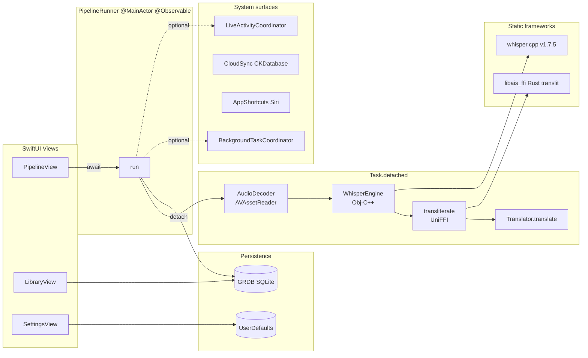

# 실전 프로젝트 활용 가이드 / Implementation Method Guide

> 이 문서는 한국어와 영어로 작성되었습니다.
> This document is written in both Korean and English.
>
> 대상 / Target: `As-It-Sounds-app/ios`
> 작성일 / Date: 2026-05-29

---

## 1. 이 저장소의 활용 목적 / Purpose of This Repository

**[한국어]**

- **분류**: 단일 목적 **iOS Application** (라이브러리/프레임워크/보일러플레이트 아님). 단, 다음 **재사용 가능 코어 패턴** 3종 보유:
  1. **whisper.cpp iOS xcframework 조립 레퍼런스** — `core/scripts/assemble-whisper-xcframework.sh` 가 업스트림 `build-xcframework.sh` 가 visionOS slice 에서 abort 한 시점에 iOS device + sim slice 만 골라 xcframework 로 조립.
  2. **Rust 코어 + UniFFI Swift binding 소비자 레퍼런스** — `core/scripts/build-ios.sh` + project.yml 의 framework + bridging header 패턴.
  3. **SwiftUI + Strict Concurrency + Obj-C++ 혼합 레퍼런스** — `WhisperEngine.mm` non-Sendable Obj-C 클래스를 `@MainActor` 러너의 `Task.detached` 안에 가두는 패턴.
- **실전에서 해결하는 문제**:
  - 영어 학습자가 발음 그대로 한글로 기록하려는 니즈
  - 외국어 인터뷰/팟캐스트 의미 + 발음 동시 파악
  - 클라우드 의존 없이 디바이스에서 STT + 자막 생성 (App Store privacy "data not collected")
- **재사용 시나리오**: 다른 SwiftUI 앱에서 `Core/WhisperEngine.{h,mm}` + `core/scripts/*` 3 스크립트 + `project.yml` framework 블록 5줄 만 복사하면 whisper.cpp 통합 즉시 완료.

**[English]**

- **Classification**: Single-purpose **iOS application** (not a library, framework, or boilerplate). It does include three **reusable core patterns**:
  1. **whisper.cpp iOS xcframework assembly recipe** — `core/scripts/assemble-whisper-xcframework.sh` picks just the iOS device + simulator slices after upstream's `build-xcframework.sh` aborts on visionOS, and stitches them into a working xcframework.
  2. **Rust core + UniFFI Swift binding consumer recipe** — the `core/scripts/build-ios.sh` flow plus the `project.yml` `framework` + bridging-header pattern.
  3. **SwiftUI + Strict Concurrency + Obj-C++ mix recipe** — fencing a non-Sendable Obj-C class (`WhisperEngine.mm`) inside a `Task.detached` from a `@MainActor` runner.
- **Real-world problems solved**:
  - Learners who want phonetic Hangul instead of dictionary spelling
  - Grasping foreign-language interviews / podcasts with sound + meaning side-by-side
  - On-device STT + subtitle generation with zero cloud dependency (App Store "data not collected" status)
- **Reuse scenarios**: Drop `Core/WhisperEngine.{h,mm}`, the three `core/scripts/*` files, and 5 lines of `project.yml` `framework` block into any SwiftUI app and whisper.cpp is integrated.

---

## 2. 아키텍처 이해 / Architecture Overview

**[한국어]**

본 앱은 **단방향 데이터 흐름 + `@Observable`** 패턴 위에 설계되었습니다. SwiftUI 뷰가 `PipelineRunner` (`@MainActor @Observable`) 를 트리거하면, 러너는 한 번의 `Task.detached` 안에서 디코드 → ASR → 음차 → 번역 → DB 저장을 순차 실행하고, 진행 상태를 `@Observable` 속성으로 노출.

**핵심 컴포넌트**:

- **SwiftUI Views**: `RootView` (TabView 4탭) → `PipelineView` / `LibraryView` / `TranslitDemoView` / `SettingsView`
- **Pipeline Layer**: `PipelineRunner` — 단일 `run(modelPath:audioURL:language:translator:)` 진입점
- **Bridges**:
  - `WhisperEngine.{h,mm}` (Obj-C++) → whisper.cpp v1.7.5 (정적 xcframework)
  - `AisCoreFFI.swift` (UniFFI 생성) → Rust `transliterate(text:)`
- **Persistence**: `AppDatabase.shared` (GRDB.swift) — Project/MediaFile/SegmentRecord 3 테이블 + DatabaseMigrator v1
- **System Surfaces**:
  - `BackgroundTaskCoordinator` (BGProcessingTask)
  - `CloudSync` (CKDatabase, scaffold)
  - `AppShortcuts` (AppIntents/Siri)
  - `LiveActivityCoordinator` (ActivityKit attrs, Widget Extension 별도 setup 필요)
  - `LiveMicSTT` (AVAudioEngine 롤링 버퍼, 라이브 STT)
- **Settings**: `AppSettings.shared` (UserDefaults @Observable)

**데이터 흐름**:

1. 사용자가 `PipelineView.fileImporter` → `URL` 획득 + `startAccessingSecurityScopedResource()`
2. View 가 `runner.run(modelPath:audioURL:...translator:)` await
3. `Task.detached` 안에서:
   - `AudioDecoder.decodeToPCM16k(url:)` → `AVAssetReader` + `AVAudioConverter` → `Data` (Float32 16k mono)
   - `WhisperEngine(modelPath:useGpu:true)?.transcribePCM(...)` → `[AisSegment]`
   - 각 segment 의 EN → `transliterate(text:)` (UniFFI) → 한글
4. main actor 로 복귀 후 `segments` 배열 갱신 → SwiftUI 자동 재렌더
5. `translator.translate(...)` 순차 호출 → `textKo` 갱신
6. `AppDatabase.shared.saveSegments(_:fileId:)` 영구화
7. `runner.stage = .done`

**[English]**

The app is built on a **unidirectional data flow + `@Observable`** pattern. A SwiftUI view triggers `PipelineRunner` (a `@MainActor @Observable` class), which serially runs decode → ASR → transliterate → translate → DB save inside a single `Task.detached`, exposing progress through `@Observable` properties.

**Core components**:

- **SwiftUI views**: `RootView` (TabView with 4 tabs) → `PipelineView` / `LibraryView` / `TranslitDemoView` / `SettingsView`
- **Pipeline layer**: `PipelineRunner` exposes one `run(modelPath:audioURL:language:translator:)` entry
- **Bridges**:
  - `WhisperEngine.{h,mm}` (Obj-C++) → whisper.cpp v1.7.5 (static xcframework)
  - `AisCoreFFI.swift` (UniFFI-generated) → Rust `transliterate(text:)`
- **Persistence**: `AppDatabase.shared` (GRDB.swift) with 3 tables and a `DatabaseMigrator` (v1)
- **System surfaces**:
  - `BackgroundTaskCoordinator` (BGProcessingTask)
  - `CloudSync` (CKDatabase, scaffold)
  - `AppShortcuts` (AppIntents / Siri)
  - `LiveActivityCoordinator` (ActivityKit attributes; the Widget Extension target must be added manually)
  - `LiveMicSTT` (AVAudioEngine rolling buffer for live STT)
- **Settings**: `AppSettings.shared` (UserDefaults-backed `@Observable`)

**Data flow**:

1. The user picks a file via `PipelineView.fileImporter`; we receive a `URL` + call `startAccessingSecurityScopedResource()`.
2. The view awaits `runner.run(modelPath:audioURL:...translator:)`.
3. Inside a `Task.detached`:
   - `AudioDecoder.decodeToPCM16k(url:)` → `AVAssetReader` + `AVAudioConverter` → `Data` (Float32 16k mono)
   - `WhisperEngine(modelPath:useGpu:true)?.transcribePCM(...)` → `[AisSegment]`
   - Each segment's English text → `transliterate(text:)` (UniFFI) → Hangul.
4. Back on the main actor, the `segments` array is replaced → SwiftUI re-renders.
5. `translator.translate(...)` is called sequentially → `textKo` is filled in.
6. `AppDatabase.shared.saveSegments(_:fileId:)` persists.
7. `runner.stage = .done`.



---

## 3. 실전 프로젝트 적용 시나리오 / Real-World Scenarios

**[한국어]**

### 시나리오 1: 토익 LC 음원 → 한글 음차 + 한국어 자막

1. iPhone Files 앱에서 `01_19_04.mp3` 공유 → "As It Sounds"
2. Transcribe 탭 → 모델 다운로드 (첫 실행) → 변환 시작
3. Whisper 가 segment 별 EN 텍스트 생성
4. translit (UniFFI) 가 한글 음차 추가
5. MyMemory 가 한국어 번역 추가
6. AVPlayer 로 재생 + ScrollViewReader 가 현재 segment 자동 하이라이트
7. Export → SRT → `UIDocumentPicker` 로 Files 앱에 저장

### 시나리오 2: 음성 메모 인터뷰 → SRT 자막

1. Voice Memos 앱 녹음 (.m4a) → Share Sheet → "As It Sounds"
2. Translator: Off (영어 원문만 필요)
3. Transcribe → segment 단위 EN
4. Export → SRT → 영상 편집기로 import

### 시나리오 3: Siri 음성 명령으로 앱 열기

1. iOS Settings → Siri → Shortcuts 에서 "As It Sounds 열기" 등록 (`OpenLatestProjectIntent`)
2. 사용자가 "헤이 시리, As It Sounds 열어줘" → 앱 자동 실행

### 시나리오 4: whisper.cpp 패턴 다른 SwiftUI 앱에 이식

1. `core/scripts/{build-ios.sh, assemble-whisper-xcframework.sh}` 복사
2. `core/third_party/whisper.cpp` clone (Step 3.4 동일)
3. 자기 프로젝트의 `project.yml` 에 다음 추가:
   ```yaml
   dependencies:
     - framework: ../core/target/whisper.xcframework
       embed: false
     - sdk: Accelerate.framework
     - sdk: Metal.framework
     - sdk: MetalKit.framework
     - sdk: CoreML.framework
   ```
4. `WhisperEngine.{h,mm}` + `AsItSounds-Bridging-Header.h` 복사
5. Swift 측에서 `WhisperEngine(modelPath:useGpu:true)?.transcribePCM(...)` 호출

### 시나리오 5: CloudKit 동기화 활성

1. Apple Developer Portal → iCloud Container 생성 (`iCloud.com.<your>.<app>`)
2. Xcode → Target → Signing & Capabilities → + Capability → iCloud → CloudKit + Container 선택
3. `CloudSync.swift` 의 `containerIdentifier` 를 본인 컨테이너로 교체
4. Library 탭에 "Push to iCloud" 버튼 추가하여 `await CloudSync.shared.pushProject(...)` 호출

**[English]**

### Scenario 1: TOEIC LC audio → Hangul + Korean subtitles

1. Share `01_19_04.mp3` from the Files app → "As It Sounds"
2. Transcribe tab → download model (first run) → tap Transcribe
3. Whisper emits EN text per segment
4. UniFFI's `transliterate(text:)` adds Hangul
5. MyMemory translator adds Korean
6. AVPlayer plays the audio and `ScrollViewReader` auto-highlights the current segment
7. Export → SRT → save via `UIDocumentPicker`

### Scenario 2: Voice Memos interview → SRT subtitles

1. Voice Memos → Share Sheet → "As It Sounds"
2. Translator: Off (English transcript only)
3. Transcribe → per-segment EN
4. Export → SRT → import into your video editor

### Scenario 3: Launch the app via Siri

1. iOS Settings → Siri → Shortcuts: register "Open As It Sounds" (binds `OpenLatestProjectIntent`)
2. "Hey Siri, open As It Sounds" → app foregrounds

### Scenario 4: Lift the whisper.cpp pattern into another SwiftUI app

1. Copy `core/scripts/{build-ios.sh, assemble-whisper-xcframework.sh}`
2. Clone `core/third_party/whisper.cpp` (same as Step 3.4)
3. Add to your own `project.yml`:
   ```yaml
   dependencies:
     - framework: ../core/target/whisper.xcframework
       embed: false
     - sdk: Accelerate.framework
     - sdk: Metal.framework
     - sdk: MetalKit.framework
     - sdk: CoreML.framework
   ```
4. Copy `WhisperEngine.{h,mm}` + `AsItSounds-Bridging-Header.h`
5. From Swift, call `WhisperEngine(modelPath:useGpu:true)?.transcribePCM(...)`

### Scenario 5: Enable CloudKit sync

1. Apple Developer Portal → create iCloud container (`iCloud.com.<your>.<app>`)
2. In Xcode → Target → Signing & Capabilities → + Capability → iCloud → check CloudKit + your container
3. Update `containerIdentifier` in `CloudSync.swift`
4. Add a "Push to iCloud" button in Library that calls `await CloudSync.shared.pushProject(...)`

---

## 4. 확장 및 커스터마이징 / Extension & Customization

**[한국어]**

**설정 변경 포인트**:

- `project.yml` — 의존성 / 빌드 설정 / Info.plist key. 변경 후 반드시 `xcodegen generate` 재실행.
- `Info.plist` (또는 `project.yml`의 `info.properties`) — 권한 문자열, `UIBackgroundModes`, `BGTaskSchedulerPermittedIdentifiers`
- `Resources/en.lproj/Localizable.strings` + `ko.lproj/Localizable.strings` — 다국어 텍스트
- `Core/AppSettings.swift` — 사용자 환경 키 (model / translator / scheme)
- `core/scripts/build-ios.sh` — Whisper 가속 옵션 변경 (Metal, BLAS, CoreML)

**기능 추가 시 수정할 파일**:

| 추가 기능 | 주요 수정 파일 |
| :-- | :-- |
| 새 번역 백엔드 | `Core/Translator.swift` — `enum TranslatorChoice` + 구현 struct |
| 새 자막 포맷 | `Core/SubtitleExport.swift` — `enum SubtitleFormat` 분기 |
| 새 DB 컬럼 | `Core/Database.swift` — record struct + migrator step 추가, version 증가 |
| 새 화면 (탭) | `Features/RootView.swift` — TabView item 추가 + Feature view 생성 |
| Apple Translation (iOS 17.4+) | `Core/Translator.swift` 에 `AppleTranslator` 구현, `TranslationSession` 활용 |
| Live mic STT UI | `Features/` 에 새 `RecordView` + `Core/LiveMicSTT` 의 `AsyncStream<Event>` 구독 |

**플러그인 / 확장 구조**: `Translator` 프로토콜이 사실상의 SPI. 새 구현 추가는 `protocol Translator: Sendable` 채택 + `TranslatorChoice` enum case + `make()` 분기.

**[English]**

**Configuration touch points**:

- `project.yml` — dependencies, build settings, Info.plist keys. **Always re-run `xcodegen generate` after changes.**
- `Info.plist` (or `project.yml`'s `info.properties`) — permission strings, `UIBackgroundModes`, `BGTaskSchedulerPermittedIdentifiers`
- `Resources/en.lproj/Localizable.strings` + `ko.lproj/Localizable.strings` — localised strings
- `Core/AppSettings.swift` — user preference keys (model / translator / scheme)
- `core/scripts/build-ios.sh` — Whisper acceleration toggles (Metal, BLAS, CoreML)

**Files to modify when adding features**:

| Feature | Files to touch |
| :-- | :-- |
| New translator backend | `Core/Translator.swift` — extend `enum TranslatorChoice` and the implementation struct |
| New subtitle format | `Core/SubtitleExport.swift` — extend `enum SubtitleFormat` and the renderer switch |
| New DB column | `Core/Database.swift` — extend the record struct, add a migrator step, bump the schema version |
| New tab / screen | `Features/RootView.swift` — add a TabView item + create the feature view |
| Apple Translation (iOS 17.4+) | Add an `AppleTranslator` struct in `Core/Translator.swift` using `TranslationSession` |
| Live mic STT UI | Add a `RecordView` in `Features/`, subscribe to `Core/LiveMicSTT`'s `AsyncStream<Event>` |

**Plugin / extension architecture**: The `Translator` protocol is the de facto SPI. Adding a backend is: implement `protocol Translator: Sendable`, add a `TranslatorChoice` enum case, and wire it in `make()`.

---

## 5. 운영 환경 배포 / Production Deployment

**[한국어]**

**프로덕션 빌드**:

```bash
# Archive (서명된 .xcarchive 생성)
xcodebuild -project AsItSounds.xcodeproj \
  -scheme AsItSounds -configuration Release \
  -archivePath build/AsItSounds.xcarchive \
  CODE_SIGN_STYLE=Manual \
  CODE_SIGN_IDENTITY="$APPLE_SIGNING_IDENTITY" \
  DEVELOPMENT_TEAM="$APPLE_TEAM_ID" \
  archive

# IPA 추출
xcodebuild -exportArchive \
  -archivePath build/AsItSounds.xcarchive \
  -exportOptionsPlist .doc/export-options.plist \
  -exportPath build/export
```

**서명** (자세한 내용 `.doc/signing.md`):

- Apple Developer Program 등록 + Distribution certificate 발급
- App ID `com.asitsounds.ios` 등록
- App Store provisioning profile 생성
- `APPLE_SIGNING_IDENTITY`, `APPLE_TEAM_ID`, `APPLE_ID`, `APPLE_PASSWORD` 환경변수 또는 CI secrets

**환경별 설정**:

- 현재: Xcode configurations `Debug` / `Release` 2개만. Beta/Staging 분리 미적용.
- 권고: Configuration 3개 (`Debug` / `Staging` / `Release`) + `xcconfig` 파일로 Translator API endpoint 분리.

**CI/CD**:

- `.github/workflows/ios.yml` — 시뮬레이터 빌드 (현재 `workflow_dispatch:` 만)
- `.github/workflows/release.yml` — 태그 push 시 archive + IPA + GitHub Releases 업로드 + (`secrets.RELEASE_IOS == 'true'` 시) 활성
- TestFlight upload 자동화: `xcrun altool --upload-app` 또는 App Store Connect API + `fastlane pilot`

**컨테이너화**: iOS 는 모바일 — Docker/K8s 무관. 단, CI 의 macOS 러너 (`macos-14`) 가 Apple Silicon 으로 자동 픽업되도록 `runs-on: macos-14` 명시 (`.github/workflows/ios.yml` 에 적용됨).

**[English]**

**Production build**:

```bash
# Archive (produces a signed .xcarchive)
xcodebuild -project AsItSounds.xcodeproj \
  -scheme AsItSounds -configuration Release \
  -archivePath build/AsItSounds.xcarchive \
  CODE_SIGN_STYLE=Manual \
  CODE_SIGN_IDENTITY="$APPLE_SIGNING_IDENTITY" \
  DEVELOPMENT_TEAM="$APPLE_TEAM_ID" \
  archive

# Export IPA
xcodebuild -exportArchive \
  -archivePath build/AsItSounds.xcarchive \
  -exportOptionsPlist .doc/export-options.plist \
  -exportPath build/export
```

**Signing** (full details in `.doc/signing.md`):

- Join Apple Developer Program + create a Distribution certificate
- Register `com.asitsounds.ios` App ID
- Create an App Store provisioning profile
- Provide `APPLE_SIGNING_IDENTITY`, `APPLE_TEAM_ID`, `APPLE_ID`, `APPLE_PASSWORD` via env vars or CI secrets

**Environment-specific config**:

- Today: only two Xcode configurations (`Debug` / `Release`). No Beta/Staging split.
- Recommended: add a third configuration with `xcconfig` files to swap the translator API endpoint per environment.

**CI/CD**:

- `.github/workflows/ios.yml` — simulator build (currently `workflow_dispatch:` only)
- `.github/workflows/release.yml` — on tag push, archive + IPA + GitHub Releases (and TestFlight upload when `secrets.RELEASE_IOS == 'true'`)
- TestFlight automation: `xcrun altool --upload-app` or App Store Connect API + `fastlane pilot`

**Containerization**: N/A at runtime (mobile app). CI uses `runs-on: macos-14` so GitHub picks an Apple Silicon runner (already configured in `.github/workflows/ios.yml`).

---

## 6. 성능 및 확장성 고려사항 / Performance & Scalability

**[한국어]**

**알려진 성능 병목**:

- **Whisper 추론** — 디바이스별 RTF (real-time factor):
  - iPhone 15 Pro (Core ML + Neural Engine): base RTF ≈ 0.25, small ≈ 0.5
  - iPhone 12 (Core ML only): base RTF ≈ 0.6
  - 시뮬레이터 (Core ML 가속 미지원): RTF 1.0+ 정상
- **AVAudioConverter 1-shot 변환** — 큰 파일 메모리 다 적재. 30분+ 음원은 청크 변환 권고.
- **번역 직렬 호출** — segment 마다 `await translator.translate(...)`. 100+ segment 면 사용자 체감 느림. `withTaskGroup` 으로 concurrency 4 권고.

**확장 전략**:

- 디바이스 RAM 가드: `ProcessInfo.processInfo.physicalMemory` 기반
  - 4 GB (iPhone 12 mini, SE) → tiny 강제
  - 6 GB (iPhone 14) → base 권장, small 옵션
  - 8 GB+ (iPhone 15 Pro+) → small 허용, medium 옵션 표시
- App Thinning + on-demand 모델 다운로드 → IPA 크기 작게 유지 (~10–20 MB device slice)

**캐싱**:

- Whisper 모델: 영구 (`Application Support/models/`) — `URLResourceValues.isExcludedFromBackup = true` 적용됨
- 번역 결과: **캐싱 없음** (현재). 향후 `LRU + sqlite cache` 권고.

**모니터링 / 로깅**:

- 현재: `os_log` + `NSLog`. 외부 sink 미연동.
- 권고:
  - **MetricKit** (`MXMetricPayload` / `MXDiagnosticPayload`) — iOS 13+ 내장
  - **Firebase Crashlytics** 또는 **Apple Crash Reports** (Xcode Organizer)
  - **OSLog signpost** — Pipeline 단계별 latency 측정

**[English]**

**Known bottlenecks**:

- **Whisper inference** dominates. Approximate RTF per device:
  - iPhone 15 Pro (Core ML + Neural Engine): base ≈ 0.25, small ≈ 0.5
  - iPhone 12 (Core ML only): base ≈ 0.6
  - Simulator (no Core ML accel): RTF 1.0+ is expected
- **AVAudioConverter one-shot conversion** loads the whole file in memory. For 30-minute+ audio, switch to chunked conversion.
- **Sequential translation** does `await translator.translate(...)` per segment. 100+ segments is perceptibly slow — use `withTaskGroup` with concurrency 4.

**Scaling strategy**:

- RAM-based gate via `ProcessInfo.processInfo.physicalMemory`:
  - 4 GB (iPhone 12 mini, SE) → force `tiny`
  - 6 GB (iPhone 14) → default `base`, allow `small`
  - 8 GB+ (iPhone 15 Pro+) → allow `small`, expose `medium`
- App Thinning + on-demand model download keep IPA size small (~10–20 MB device slice).

**Caching**:

- Whisper model: permanently cached at `Application Support/models/` with `isExcludedFromBackup = true`.
- Translations: **no cache today**. Add an LRU + SQLite cache table.

**Monitoring / logging**:

- Current: `os_log` + `NSLog`, no external sink.
- Recommended:
  - **MetricKit** (`MXMetricPayload` / `MXDiagnosticPayload`) — built into iOS 13+
  - **Firebase Crashlytics** or Apple Crash Reports (Xcode Organizer)
  - **OSLog signposts** for per-stage Pipeline latency measurements

---

## 7. 보안 체크리스트 / Security Checklist

**[한국어]**

- [ ] **환경 변수 / 시크릿**:
  - 현재: `UserDefaults` (시크릿 미포함). 빌드 시크릿은 CI secrets + Xcode 사용자 build settings
  - DeepL API 키 입력 UI 추가 시 → **Keychain** (`kSecAttrAccessibleAfterFirstUnlockThisDeviceOnly`)
- [ ] **인증/인가**: 본 앱은 사용자 계정 없음. CloudKit 사용 시 Apple ID 가 자동 인증
- [ ] **의존성 취약점 점검**:
  - SwiftPM 의존성 (현재 GRDB 만) → `swift package show-dependencies` 정기 확인
  - whisper.cpp / ggml — GitHub watch 알림으로 신규 릴리스 추적
  - 도구 권고: OSV-Scanner, Snyk
- [ ] **알려진 보안 고려사항**:
  - **NSAppTransportSecurity** 명시 미적용 → 기본 ATS 적용됨 (HTTPS only, TLS 1.2+). 번역 도메인 화이트리스트로 좁히는 것이 더 안전.
  - **Whisper 모델 SHA256 검증 부재** → MitM 위험. `ModelManager.swift` 의 `urlSession(_:downloadTask:didFinishDownloadingTo:)` 에 hash 검증 추가 권고.
  - **`allowBackup`**: iCloud 백업이 모델 142~466 MB 동기화 시작 = 사용자 iCloud 용량 폭주. `URLResourceValues.isExcludedFromBackup = true` 적용됨 ✓.
  - **Privacy Manifest** (PrivacyInfo.xcprivacy) — iOS 17 요구사항. 본 프로젝트 부재 — App Store 출시 전 추가 필수.

**[English]**

- [ ] **Env / secret management**:
  - Current: `UserDefaults` (no secrets in it). Build secrets live in CI secrets + Xcode user build settings.
  - When the DeepL API-key UI ships → store via **Keychain** (`kSecAttrAccessibleAfterFirstUnlockThisDeviceOnly`).
- [ ] **Auth / authz**: No user accounts in this app. CloudKit relies on the user's iCloud account (zero extra auth).
- [ ] **Dependency vulnerability scanning**:
  - SwiftPM deps (GRDB only) → run `swift package show-dependencies` periodically.
  - whisper.cpp / ggml — watch the GitHub repo for releases.
  - Tools: OSV-Scanner, Snyk.
- [ ] **Known security considerations**:
  - **NSAppTransportSecurity** is not explicitly configured → the iOS default (HTTPS only, TLS 1.2+) applies. Narrow to a domain allowlist for translator APIs.
  - **No SHA256 verification on Whisper model downloads** → MitM exposure. Add hash verification in `ModelManager.swift`'s `urlSession(_:downloadTask:didFinishDownloadingTo:)`.
  - **iCloud backup**: a backed-up 142–466 MB model would balloon the user's iCloud quota. `URLResourceValues.isExcludedFromBackup = true` is already applied ✓.
  - **Privacy Manifest** (`PrivacyInfo.xcprivacy`) — required by iOS 17 but absent. Add before App Store submission.

---

## 8. 관련 참고 자료 / References

**[한국어]**

- **공식 문서**
  - [SwiftUI](https://developer.apple.com/documentation/swiftui)
  - [Observation framework (iOS 17)](https://developer.apple.com/documentation/observation)
  - [Swift Strict Concurrency](https://www.swift.org/documentation/concurrency/)
  - [AVFoundation](https://developer.apple.com/documentation/avfoundation)
  - [BackgroundTasks (BGProcessingTask)](https://developer.apple.com/documentation/backgroundtasks)
  - [CloudKit](https://developer.apple.com/documentation/cloudkit)
  - [AppIntents](https://developer.apple.com/documentation/appintents)
  - [ActivityKit](https://developer.apple.com/documentation/activitykit)
- **whisper.cpp**
  - [ggerganov/whisper.cpp](https://github.com/ggerganov/whisper.cpp)
  - [whisper.objc 예제](https://github.com/ggerganov/whisper.cpp/tree/master/examples/whisper.objc)
  - [Core ML 변환 가이드](https://github.com/ggerganov/whisper.cpp/blob/master/models/README.md#core-ml-support)
- **GRDB.swift**
  - [공식 문서](https://github.com/groue/GRDB.swift)
  - [Migrations](https://swiftpackageindex.com/groue/grdb.swift/documentation/grdb/migrations)
- **UniFFI**
  - [Mozilla UniFFI Swift 가이드](https://mozilla.github.io/uniffi-rs/swift/)
- **xcodegen**
  - [yonaskolb/XcodeGen](https://github.com/yonaskolb/XcodeGen)
  - [Project Spec reference](https://github.com/yonaskolb/XcodeGen/blob/master/Docs/ProjectSpec.md)

> 참고: 공식 문서 기반 권장 사항 / Note: Recommended based on official documentation

**유사 프로젝트 비교**:

| 프로젝트 | 장점 | 단점 |
| :-- | :-- | :-- |
| 본 프로젝트 (As It Sounds iOS) | 한글 음차 IP, 데스크탑/Android 코어 공유, 모던 SwiftUI iOS 17 stack | 1인 메인테이너, 테스트 부재 |
| [WhisperKit](https://github.com/argmaxinc/WhisperKit) (Argmax) | Pure Swift, Core ML 네이티브 통합, 활발한 메인테이너 | 음차/번역 분리 필요, 한국어 번역 미포함 |
| Apple Speech framework | iOS 내장, 무료, 영어 매우 정확 | 다국어 정확도 변동, on-device 일부만, 한글 음차 불가 |
| Picovoice Cheetah/Leopard | 상업 STT iOS SDK, 안정성 | 모델 가중치 클로즈드, 라이선스 유료 |
| Sherpa-onnx | 다양한 STT 모델 (Whisper 포함), iOS 지원 | 통합 복잡도, 음차/번역 별도 |

**[English]**

- **Official docs**
  - [SwiftUI](https://developer.apple.com/documentation/swiftui)
  - [Observation framework (iOS 17)](https://developer.apple.com/documentation/observation)
  - [Swift Strict Concurrency](https://www.swift.org/documentation/concurrency/)
  - [AVFoundation](https://developer.apple.com/documentation/avfoundation)
  - [BackgroundTasks (BGProcessingTask)](https://developer.apple.com/documentation/backgroundtasks)
  - [CloudKit](https://developer.apple.com/documentation/cloudkit)
  - [AppIntents](https://developer.apple.com/documentation/appintents)
  - [ActivityKit](https://developer.apple.com/documentation/activitykit)
- **whisper.cpp**
  - [ggerganov/whisper.cpp](https://github.com/ggerganov/whisper.cpp)
  - [whisper.objc example](https://github.com/ggerganov/whisper.cpp/tree/master/examples/whisper.objc)
  - [Core ML conversion guide](https://github.com/ggerganov/whisper.cpp/blob/master/models/README.md#core-ml-support)
- **GRDB.swift**
  - [Official docs](https://github.com/groue/GRDB.swift)
  - [Migrations](https://swiftpackageindex.com/groue/grdb.swift/documentation/grdb/migrations)
- **UniFFI**
  - [Mozilla UniFFI Swift guide](https://mozilla.github.io/uniffi-rs/swift/)
- **xcodegen**
  - [yonaskolb/XcodeGen](https://github.com/yonaskolb/XcodeGen)
  - [Project Spec reference](https://github.com/yonaskolb/XcodeGen/blob/master/Docs/ProjectSpec.md)

> Note: Recommended based on official documentation

**Comparison with similar projects**:

| Project | Pros | Cons |
| :-- | :-- | :-- |
| This project (As It Sounds iOS) | Proprietary Hangul transliteration, shared desktop/Android core, modern SwiftUI iOS 17 stack | Single maintainer, no tests |
| [WhisperKit](https://github.com/argmaxinc/WhisperKit) (Argmax) | Pure Swift, native Core ML integration, active maintainer | Transliteration / translation separate, no Korean translation |
| Apple Speech framework | Built into iOS, free, very accurate for English | Multilingual accuracy varies, partial on-device, no Hangul transliteration |
| Picovoice Cheetah / Leopard | Commercial iOS STT SDK, stable | Closed weights, paid license |
| Sherpa-onnx | Multiple STT models incl. Whisper, iOS supported | Higher integration cost, transliteration/translation separate |
