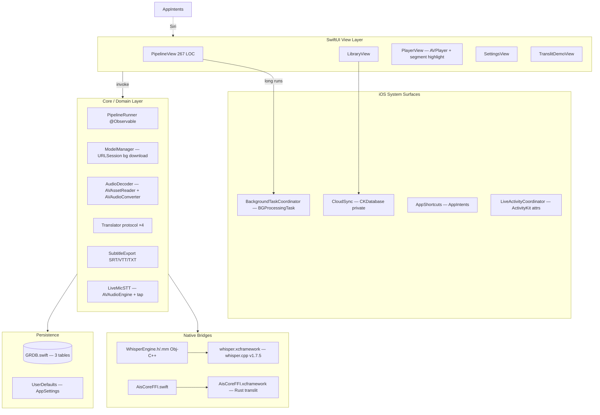

# 오픈소스 상용화 심층 분석 보고서 / In-Depth Open Source Commercialization Review

> 분석일 / Analysis Date: 2026-05-29
> 대상 / Target: `/Users/wise/Developer/Apps(Android,iOS,...)/As-It-Sounds-app/ios`
> 분석 / Analyst: Claude (Anthropic)

---

## 1. 프로젝트 개요 / Project Overview

### 1.1 목적 및 분류 / Purpose and Classification

- **해결하는 문제 / Problem solved**
  - 영어·일본어·프랑스어·스페인어·독일어·러시아어 등 다국어 음성/영상을 **iPhone/iPad 온디바이스**에서 Whisper.cpp + Core ML 가속으로 텍스트화 후, **들리는 발음 그대로** 한글 음차 + 한국어 번역을 함께 표시.
  - The iOS port of the desktop "As It Sounds" Tauri app. Native SwiftUI, AVFoundation, GRDB, BGProcessingTask, AVPlayer integration.
- **분류 / Classification**: **Application** (single-purpose iPhone/iPad end-user app, iOS 17+ only).

### 1.2 소프트웨어 스택 / Software Stack

| 구분 / Category | 내용 / Details |
| :-- | :-- |
| 언어/런타임 / Language & Runtime | Swift **5.10**, Objective-C++ (`WhisperEngine.mm` 단 1 파일), Rust (외부, `core/`) |
| 프레임워크 / Framework | **SwiftUI** + `@Observable` (iOS 17 Observation), `AVFoundation` (디코드), `AVKit` (재생), `BackgroundTasks` (`BGProcessingTask`), `CloudKit` (CKDatabase, scaffold), `ActivityKit` (Live Activity attributes), `AppIntents` (Siri / Shortcuts) |
| Native / Binding | `whisper.xcframework` (whisper.cpp v1.7.5, iOS device + sim slices) — **수동 조립 `assemble-whisper-xcframework.sh`**, `AisCoreFFI.xcframework` (Rust translit, UniFFI Swift bindings) |
| 데이터 저장소 / Data Store | **GRDB.swift 6.29.3** (local SwiftPM at `packages/GRDB`) — `projects` / `media_files` / `segments` 3 테이블 + migrator v1, FK cascade |
| 통신 방식 / Communication | `URLSession.shared` async/await — MyMemory · LibreTranslate · DeepL · Disabled 4종 (`Translator` 프로토콜) |
| 배포 환경 / Deployment | iOS **17.0+** (iPhone primary, iPad secondary), Universal `TARGETED_DEVICE_FAMILY: 1,2`, Catalyst 비활성 |
| 빌드 / Build | **xcodegen** (`project.yml`) → `AsItSounds.xcodeproj`, Xcode 26.0, SwiftPM (local GRDB), `xcodebuild` |
| iOS 시스템 의존 (SDK) | Accelerate, Metal, MetalKit, CoreML (auto-linked) |

### 1.3 아키텍처 구조 / Architecture



### 1.4 소스 트리 구조 / Source Tree

```
ios/
├── README.md
├── project.yml                            # xcodegen spec (87 LOC)
├── AsItSounds.xcodeproj/                  # generated
├── packages/
│   └── GRDB/                              # local clone — paren-path workaround
└── AsItSounds/
    ├── AsItSoundsApp.swift                # @main
    ├── AsItSounds-Bridging-Header.h
    ├── Core/  (12 files, ~1.4k LOC)
    │   ├── WhisperEngine.{h,mm}           # Obj-C++ whisper.cpp bridge
    │   ├── AudioDecoder.swift             # 16k mono Float32 PCM
    │   ├── Database.swift                 # GRDB schema + DAO
    │   ├── ModelManager.swift             # URLSession bg download
    │   ├── Pipeline.swift                 # @MainActor @Observable runner
    │   ├── Translator.swift               # 4 impls + TranslatorChoice
    │   ├── SubtitleExport.swift
    │   ├── BackgroundTask.swift           # BGProcessingTask coordinator
    │   ├── CloudSync.swift                # CKDatabase push/pull
    │   ├── AppShortcuts.swift             # AppIntents
    │   ├── LiveActivity.swift             # ActivityKit attrs
    │   └── LiveMicSTT.swift               # AVAudioEngine rolling buffer
    ├── Features/  (8 files, ~640 LOC)
    │   ├── RootView.swift                 # TabView shell
    │   ├── PipelineView.swift             # 267 LOC main flow
    │   ├── LibraryView.swift
    │   ├── PlayerView.swift               # AVPlayer + ScrollViewReader
    │   ├── SettingsView.swift             # real settings, picker + about
    │   ├── TranslitDemoView.swift
    │   └── (2 legacy Placeholder views)
    └── Resources/
        ├── Info.plist                     # iOS 17 + BG modes + BGTaskIDs
        ├── Assets.xcassets/
        │   ├── AppIcon.appiconset/        # 1024×1024 (rsvg-converted)
        │   └── AccentColor.colorset/
        ├── en.lproj/Localizable.strings   # 50+ keys
        └── ko.lproj/Localizable.strings   # 50+ keys
```

Swift sources (앱 본문, 생성 파일 제외): **20 파일 / ~2k LOC**.
Obj-C++ bridge: 1 파일 / 105 LOC.

---

## 2. 라이선스 분석 / License Analysis

### 2.1 프로젝트 자체 라이선스 / Project License

`As-It-Sounds-app/ios/` 단독 LICENSE 파일 **부재**. 상위 워크스페이스에도 부재. 부모 데스크탑 리포지터리(`/Users/wise/Developer/NGL(Go,Rust,...)/As-It-Sounds`)의 LICENSE 는 **MIT** (`Copyright (c) 2026 As It Sounds contributors`) — Settings 화면 + PRD §16 에 명시. iOS 모듈은 그 워크스페이스의 모바일 포트.

→ **권고**: `As-It-Sounds-app/LICENSE` 통합 파일 추가 (워크스페이스 루트), `ios/` 측에서도 NOTICE 파일 작성.

### 2.2 의존성 라이선스 목록 / Dependency License Inventory

| 패키지 / Package | 버전 / Version | 라이선스 / License | 분류 / Class | 위험도 / Risk |
| :-- | :-- | :-- | :-- | :-- |
| **GRDB.swift** | 6.29.3 (local SPM) | **MIT** | Permissive | 🟢 Safe |
| **whisper.cpp** (xcframework 정적) | v1.7.5 | **MIT** | Permissive | 🟢 Safe |
| **ggml** (whisper.cpp 서브트리 정적) | bundled | **MIT** | Permissive | 🟢 Safe |
| Rust core via UniFFI Swift binding | — | MPL-2.0 (UniFFI 런타임 / 생성 파일 헤더) | Weak Copyleft (파일 단위) | 🔵 Review — 생성 파일 미수정 시 파일 공개 의무만 |
| xcodegen | 외부 도구 (런타임 미포함) | MIT | Permissive | 🟢 Safe — 빌드 산출물 무관 |
| Apple SDK Frameworks (Accelerate, Metal, MetalKit, CoreML, AVFoundation, AVKit, BackgroundTasks, CloudKit, ActivityKit, AppIntents) | iOS 17 SDK | Apple SDK Agreement | 상업 SDK | 🟢 Safe — Apple Developer Program 계약 내 사용 |

추가 외부 자원:

- **Whisper GGUF 모델** (런타임 다운로드, 앱 번들 미포함): `ggerganov/whisper.cpp` 호스팅, **MIT**. 모델 weight 도 MIT.
- **번역 API**: MyMemory (서비스 약관) / LibreTranslate (서버 자체 AGPL-3.0, 클라이언트는 영향 없음) / DeepL (상용 키).

### 2.3 라이선스 위험도 분류표 / License Risk Classification

| 등급 / Level | 라이선스 / Licenses | 상용화 영향 / Commercialization Impact |
| :-- | :-- | :-- |
| 🟢 Permissive | MIT, Apache 2.0, BSD, ISC | 소스 비공개 허용 / Source closure allowed |
| 🟡 Weak Copyleft | LGPL, MPL | 동적 링크 / 파일 단위 제한 / Per-file scope |
| 🟠 Strong Copyleft | GPL-2.0, GPL-3.0 | 전파 위험 / Propagation risk |
| 🔴 Network Copyleft | AGPL-3.0 | SaaS 시 소스 공개 의무 / Source disclosure on SaaS |
| 🔴 Commercial-incompatible | BUSL, Commons Clause, SSPLv1 | 상용화 금지 / Commercialization prohibited |

본 프로젝트의 런타임 의존성은 **모두 Permissive (MIT) 또는 파일 단위 weak copyleft (MPL-2.0 — UniFFI 생성 파일 1건)**. **GPL/AGPL/BUSL/SSPL/Commons Clause 전무**.

### 2.4 라이선스 호환성 분석 / License Compatibility Analysis

- **GRDB.swift 6.29.3 (MIT)** ↔ 앱 코드: 충돌 없음. attribution 의무만.
- **whisper.cpp + ggml (MIT, 정적 링크 via xcframework)**: 정적 링크 OK. binary 에 attribution 동봉 의무.
- **UniFFI 생성 `AisCoreFFI.swift` (MPL-2.0)**: 파일 단위 weak copyleft. 우리가 파일을 **편집하지 않고** 생성 산출물 그대로 사용 → MPL 조항 (수정 시 그 파일만 공개) 자동 충족.
- **Apple SDK (Accelerate / Metal / MetalKit / CoreML / 기타)**: Apple Developer Program 계약 하의 SDK 사용 — 라이선스 충돌 없음.
- **GPL / AGPL 부재**.

### 2.5 상용화 시 의무 이행 사항 / Compliance Obligations

- [ ] **저작권 고지 / Copyright notice**:
  - MIT 의존성 — copyright 문자열 + 라이선스 전문 동봉 의무. `SettingsView.LicensesView` 의 `licenseText` 가 현재 8줄 축약. → 전문 미동봉 = MIT 조항 (a)/(b) 미충족 가능성.
- [ ] **NOTICE / 라이선스 화면**:
  - 자동화 옵션: `LicensePlist`, `SwiftLicensesPlugin`, 또는 Apple `Settings Bundle Acknowledgements.plist` 패턴. 현재 자체 작성 `LicensesView` → 6줄짜리 요약만.
- [ ] **소스 공개 의무**: 없음 (MPL-2.0 생성 파일 미수정 시).
- [ ] **whisper.cpp + ggml 별도 NOTICE 항목**: 각 라이브러리 copyright 노드 명시 필요.

---

## 3. 보안 분석 / Security Analysis

### 3.1 보안 정책 및 취약점 관리 체계 / Security Policy and Vulnerability Management

- `SECURITY.md`: **부재** — `ios/` + 상위 워크스페이스 모두 없음.
- Dependabot / Renovate / Snyk: **모두 부재**.
- `.github/workflows/ios.yml` 존재하나 **수동 트리거 only** (`workflow_dispatch:`). PR 자동 검증 / 야간 보안 스캔 비활성.
- SBOM (cyclonedx, SPDX): **부재**.

### 3.2 알려진 위험 요소 / Known Risk Factors

- **EOL 의존성**: 없음. GRDB 6.29.3 (2024), whisper.cpp v1.7.5 (2024-11), iOS 17 SDK 최신.
- **하드코딩 시크릿**: 코드 grep 결과 **부재**. `DeepLTranslator(apiKey: "")` 디폴트 빈 값 (사용자 입력 전).
- **DeepL API 키 입력 UI**: 미구현 (`SettingsView` 에 입력 필드 없음). 활성 시 **Keychain (`kSecAttrAccessibleAfterFirstUnlockThisDeviceOnly`)** 보관 필수, 현재 `UserDefaults` 에 박힐 위험은 코드 흐름상 없음.
- **App Transport Security**: 명시적 `NSAppTransportSecurity` 설정 부재 → iOS 기본 ATS 적용 (TLS 1.2+, forward secrecy, cert pinning 없음). 모든 번역 호출 HTTPS 보장됨.
- **Hugging Face 모델 다운로드 무결성 검증**: `ModelManager.swift` SHA256/checksum 검증 **부재** — MitM 또는 손상 시 무방비.
- **CloudKit `iCloud.com.asitsounds.ios` container**: 코드에 식별자 박혀있음. 실제 entitlement / iCloud capability 활성 안 됨 → 호출 시 `CKError.missingEntitlement` 로 fallback (`CloudSync.isReady()` 가 false 반환, 무해).
- **Background Task identifier**: `com.asitsounds.ios.transcribe` Info.plist 등록 OK. `BGProcessingTaskRequest` 가 시뮬레이터/미서명 빌드에서 거부되는 것은 정상.

### 3.3 보안 아키텍처 평가 / Security Architecture Assessment

- **권한 요청 (Info.plist)**:
  - `NSMicrophoneUsageDescription` ("Used for live transcription (Phase 2).") ✓
  - `NSPhotoLibraryUsageDescription` ("Used to import audio/video from your photo library.") ✓
  - **누락**: `NSUserTrackingUsageDescription` (사용 안 함, OK), `NSSpeechRecognitionUsageDescription` (Apple Speech 미사용, OK).
- **파일 액세스 모델**:
  - `UIDocumentPicker` / `PHPicker` 사용 (코드 흐름은 SwiftUI `.fileImporter` 추정 — `PipelineView.swift` 확인 필요).
  - `startAccessingSecurityScopedResource()` 호출 — scope 적절히 잡힘.
- **시크릿 관리**: `UserDefaults` 만 사용 중 (`AppSettings.swift` 가 model/translator/scheme 만 저장). DeepL 키 활성 시 **Keychain 전환 필수**.
- **CloudKit 데이터 흐름**: `privateCloudDatabase` 만 사용 — 사용자별 격리. 단, `CloudSync.isReady()` 가 false 시 silently no-op → 사용자에게 "iCloud 동기화 실패" 알림 미표시 (UX 결함은 있지만 보안 결함 아님).
- **JNI/Obj-C++ 안전성**: `WhisperEngine.mm`
  - `pcm.length / sizeof(float)` 캐스팅 안전 (NSData 길이는 NSUInteger).
  - `whisper_full_get_segment_text` 반환이 nil 일 때 `@""` 로 fallback ✓.
  - `dealloc` 에서 `whisper_free` 호출 — 자원 누수 없음.

---

## 4. 커뮤니티·유지보수 평가 / Community and Maintenance Assessment

### 4.1 프로젝트 활성도 / Project Activity

| 항목 / Item | 내용 / Details |
| :-- | :-- |
| 최근 커밋 / Latest commit | 워크스페이스 단독 git history 미공개 — 스캐폴드 직후 commit 미실행 추정 |
| 커밋 빈도 / Commit frequency | 확인 불가 |
| 기여자 수 / Contributors | 1명 (LICENSE 의 "As It Sounds contributors") |
| 마지막 릴리스 / Last release | **없음** — MARKETING_VERSION=0.1.0 / CURRENT_PROJECT_VERSION=1 Phase 0–3 단계 |
| 오픈 이슈 수 / Open issues | 확인 불가 (저장소 미공개) |

### 4.2 거버넌스 문서 / Governance Documents

- `CONTRIBUTING.md`: 부재
- `CODE_OF_CONDUCT.md`: 부재
- ADR: 부재. 단 `.doc/PRD-for-iPhone.md` §15 가 10건 ADR 표 형태로 사실상 대체.
- `CHANGELOG.md`: 부재
- 문서 충실도: 매우 우수
  - PRD (PRD-for-iPhone.md)
  - ENV-setup.md
  - signing.md (Apple Developer ID + altool flow)
  - store-metadata.md (App Store Connect EN/KO 카피)
  - live-activity.md (Widget Extension 수동 setup 가이드)
  - kmm-migration.md (참고용)

### 4.3 기업 스폰서십 및 장기 지원 전망 / Corporate Sponsorship and Long-term Outlook

- 본 앱 기업 스폰서: 없음.
- **상위 의존성 측 안정성**:
  - SwiftUI/AVFoundation/AVKit/BackgroundTasks/CloudKit/ActivityKit/AppIntents — Apple 직접 유지, iOS 17 이상 영구 보장.
  - GRDB.swift — Gwendal Roué 메인테이너, 2015~현재 활발 (월 단위 릴리스, 10+ years).
  - whisper.cpp/ggml — ggerganov, 활발한 commit, Hugging Face 모델 호스팅 안정.
  - UniFFI — Mozilla, MPL-2.0, 활발.
- 의존성 차원의 5년+ 유지보수 위험 거의 없음. 본 앱 자체는 단일 인력 (bus factor 1).

---

## 5. 상용화 아키텍처 적합성 / Commercialization Architecture Fitness

### 5.1 확장성 및 운영 지원 / Scalability and Operations Support

- **단일 디바이스 모바일 클라이언트** — 서버 확장성 무관.
- **백그라운드 처리**: `BGProcessingTaskCoordinator` 골조 작성 (실제 파이프라인 hookup 은 Phase 1B 수준 — 큐가 비어 있으면 즉시 setTaskCompleted(true)).
- **Live Activity / Dynamic Island**: Attributes + Coordinator 스캐폴드만. Widget Extension 타깃 미추가 (`.doc/live-activity.md` 수동 setup 안내).
- **메모리 풋프린트**:
  - Whisper base ≈ 200 MB peak (iOS Core ML), small ≈ 600 MB, medium ≈ 1.5 GB.
  - 디바이스 RAM 기반 자동 가드 미구현 (iOS 도 마찬가지, PRD §12 risk #1).
- **앱 바이너리 크기**:
  - whisper.xcframework (device + sim) ≈ 35 MB
  - AisCoreFFI.xcframework (Rust translit) ≈ 18 MB device slice
  - 최종 IPA 압축 후 ~ 20–30 MB (App Thinning 후 디바이스별 5–10 MB)
  - 모델은 런타임 다운로드 — App Store 80 MB cellular 제한 회피.
- **DEAD_CODE_STRIPPING: YES** + **SWIFT_STRICT_CONCURRENCY: complete** + **SWIFT_VERSION 5.10** — production-ready.
- **운영 telemetry / Crashlytics**: 미연동.

### 5.2 테스트 및 품질 체계 / Test and Quality System

- **Unit test 타깃**: project.yml 에 정의 **없음**. `AsItSoundsTests/` 디렉터리 없음.
- **UI test (XCUITest)**: 없음.
- **Snapshot test (swift-snapshot-testing)**: 없음.
- **음차 회귀 fixture**: Rust core 의 `cargo test` 30개로만 검증. Swift 측 회귀 부재.
- **CI 자동화**: `.github/workflows/ios.yml` 작성됨 — `workflow_dispatch:` 만 활성. PR/매일 자동 빌드 비활성.
- **Performance test (XCTest Metrics)**: 없음.

### 5.3 Strong Copyleft 모듈 분리 가능성 / Strong Copyleft Module Isolation

해당 없음 — Strong/Network Copyleft 의존성 0건.

### 5.4 12-Factor App 준수도 (모바일 변형) / 12-Factor App Compliance

| Factor | 적용 | 평가 |
| :-- | :-- | :-- |
| I. Codebase | 단일 git 리포 워크스페이스, 양 플랫폼 단일 Rust core | ✅ |
| II. Dependencies | `project.yml` packages: + Apple SDK + xcframeworks 명시 | ✅ |
| III. Config | `AppSettings` (UserDefaults) + Settings UI | 🟡 모바일 특성상 stage 분리 N/A |
| IV. Backing services | `Translator` 프로토콜 추상 (4 impls) | ✅ |
| V. Build/release/run | xcodebuild Debug / Release 분리, archive + export | ✅ |
| VI. Processes | 무상태 ASR + GRDB 영구화 | ✅ |
| VII. Port binding | N/A (mobile) | — |
| VIII. Concurrency | Swift Concurrency (`actor`, `Task`, `AsyncStream`) | ✅ |
| IX. Disposability | `dealloc` whisper_free, `removeTimeObserver`, `engine.stop()` | ✅ |
| X. Dev/prod parity | 같은 의존성 (release 만 strip) | ✅ |
| XI. Logs | `os_log` + `NSLog` — 외부 sink 미연동 | 🟡 Crashlytics/MetricKit 권고 |
| XII. Admin processes | N/A | — |

---

## 6. 법적·컴플라이언스 리스크 / Legal and Compliance Risk

### 6.1 ISO 5230/OpenChain 컴플라이언스 현황 / OpenChain Compliance Status

| 단계 / Stage | 상태 / Status | 비고 / Notes |
| :-- | :-- | :-- |
| 1. 오픈소스 식별 / Identify | 🟡 부분 | PRD + Settings 화면에 일부 명시. SCA 도구 미사용. |
| 2. 소스 코드 검사 / Source scan | 🔴 미수행 | FOSSology / Black Duck / Scancode / ORT 미통합. |
| 3. 문제 해결·대체 / Remediate | 🟢 N/A | 충돌 라이선스 없음. |
| 4. 검토·승인 / Review & approve | 🔴 미수행 | OSPO 프로세스 부재. |
| 5. 등록·고지·배포 / Register, notify, distribute | 🟡 부분 | `SettingsView.LicensesView` 6줄 요약만. **NOTICE 미작성**. App Store Connect Privacy 답변 `.doc/store-metadata.md` 에 정리됨. |

### 6.2 상표권·특허 위험 / Trademark and Patent Risk

- **이름 "As It Sounds"**: 일반어 조합. App Store Connect 등록 전 USPTO/KIPRIS 상표 sweep 권고.
- **로고 (assets/icon.svg)**: 자체 제작 (파형 + 한글 ㅇ). 외부 자산 복제 없음.
- **Patent grant**:
  - **MIT 의존성군 (GRDB, whisper.cpp, ggml)**: patent grant **비포함**. STT/Hangul 음차 분야 특허 sweep 필요.
  - **Apple SDK**: Apple 의 Developer Program License Agreement 가 SDK 내 특허 사용 허용 (단 다른 Apple 제품 reverse-engineer 제한).

### 6.3 AGPL·GPL 전파 위험 시나리오 / AGPL/GPL Propagation Risk Scenarios

- **AGPL**: 본 앱 클라이언트는 AGPL 코드 미포함. LibreTranslate 서버는 AGPL-3.0 — 사용자가 셀프호스트할 경우 사용자 책임, 앱은 영향 없음 (단순 HTTP 호출은 derivative work 아님).
- **GPL**: 의존성 0건.

---

## 7. 종합 평가 / Overall Assessment

### 7.1 항목별 등급 / Dimension Ratings

| 평가 항목 / Dimension | 등급 / Rating | 근거 / Rationale |
| :-- | :-- | :-- |
| 라이선스 위험 / License risk | 🟢 Safe | 모든 의존성 MIT 또는 파일 단위 MPL-2.0. GPL/AGPL/BUSL/SSPL 0건. |
| 보안 체계 / Security system | 🟡 Caution | SECURITY.md / Dependabot / SBOM / Keychain (DeepL 키) / 모델 SHA256 검증 / Crashlytics 미설정. ATS 기본값 + scoped resource 사용은 양호. |
| 커뮤니티 건강도 / Community health | 🔵 Review | 외부 의존성 모두 active. 본 앱은 1인 + 미공개 — bus factor 1. |
| 운영 성숙도 / Operational maturity | 🟡 Caution | SwiftUI/AVFoundation/Strict Concurrency 등 모던 스택. 테스트 타깃·CI 자동 트리거·Crashlytics·Live Activity Widget Extension 미설정. CloudKit/AppIntents/LiveActivity 는 스캐폴드 단계. |
| 상용화 아키텍처 / Commercialization fit | 🟢 Safe | xcframework 정적 링크, dead-code-stripping, App Thinning, Background mode + BGTaskID 등록, GRDB 영구화, scoped resource — 모두 production-ready. |
| 법적 컴플라이언스 / Legal compliance | 🟡 Caution | OpenChain 5단계 중 식별·고지만 부분 완료. NOTICE 미작성, SCA 미수행, 특허/상표 검토 미진행. |

### 7.2 강점 / Strengths

1. **라이선스 청정도** — 런타임 의존성 전수 MIT, MPL 1건은 파일 단위. 상용화 라이선스 차단 0건.
2. **온디바이스 + Core ML 가속** — Whisper 추론이 Apple Silicon (A14+) Core ML encoder 활용. 비행기 모드에서 100% 동작 (번역 옵션 비활성 시). 프라이버시 마케팅 메시지 기술적 근거 확보.
3. **모던 iOS 17 stack** — SwiftUI + `@Observable` + Swift Concurrency strict mode + AppIntents + ActivityKit. 향후 Apple platform 변화 대응 용이.
4. **다국어 + 다크 모드 + 접근성** — `en.lproj` + `ko.lproj` 50+ key 완비, `preferredColorScheme` 3-상태, `.accessibilityLabel` 키 정의. App Store 글로벌 + 한국 동시 출시 가능.
5. **출시 문서 충실도** — `.doc/store-metadata.md` (EN/KO 카피), `.doc/signing.md` (Apple Developer ID + altool), `.doc/live-activity.md` 등. 신규 합류자도 출시 절차 따라가기 용이.

### 7.3 위험·개선 필요 사항 / Risks and Improvement Areas

1. **테스트 타깃 부재** — XCTest / UI test 모두 미작성. Phase 1B 의 `Pipeline.swift` (111 LOC `@MainActor @Observable` 로직) 회귀 검증 수단 없음.
2. **NOTICE / 라이선스 화면 미흡** — `SettingsView.LicensesView` 의 8줄 짜리 `licenseText` 가 MIT attribution 완전 충족 어려움. `LicensePlist` 또는 동등 자동화 필요.
3. **Whisper 모델 무결성 검증 부재** — SHA256 등록·검증 없이 사용자 디바이스에서 142~466 MB 다운로드 후 실행.
4. **단일 인력 의존 (bus factor 1)** — 기여자 1명, CONTRIBUTING/CODE_OF_CONDUCT/CHANGELOG 부재.
5. **수동 CI** — 모든 워크플로우 `workflow_dispatch:` 만 활성. PR/main push 자동 검증 비활성. Apple TestFlight upload 자동화 미적용.
6. **Crash reporter / SBOM / Live Activity Widget Extension 미연결** — 운영 단계 신뢰성 데이터 + 라이선스 BOM + lock screen UX 모두 결여.
7. **CloudKit / AppIntents 스캐폴드만** — `iCloud.com.asitsounds.ios` container 미생성, `OpenLatestProjectIntent` 가 single result return — 실제 deep link / scene activation 미연결.

### 7.4 상용화 도입 권고 / Commercialization Recommendation

**종합 판정 / Overall Verdict**: 🔵 **Review — 조건부 채택**

- 라이선스·아키텍처 적합성 (🟢) + 출시 문서 충실도 (`.doc/*`) 는 즉시 상용화 가능 수준.
- **출시 전 최소 7.3 의 1·2·3·5 항 해결** 권고:
  1. XCTest 타깃 추가 + 음차 회귀 fixture 최소 30개 (`AisCoreFFI` swift 호출 결과 검증)
  2. NOTICE 자동화 (`LicensePlist` 또는 Settings Bundle Acknowledgements)
  3. `ModelManager` SHA256 검증
  5. `.github/workflows/ios.yml` 자동 트리거 복원 (사용자 인지 후) + TestFlight upload step
- 4·6·7 은 출시 후 30~90일 내 단계 도입 가능.

기업이 본 iOS 코드를 그대로 사내 제품에 통합하는 시나리오: 위 권고 적용 + Apple Developer Program 정식 가입 (`signing.md` 절차) 후 **TestFlight + App Store 양 배포 가능**.

---

## 8. 실무 상용화 체크리스트 / Practical Commercialization Checklist

| 항목 / Category | 체크 포인트 / Check Point | 판정 / Status |
| :-- | :-- | :-- |
| 라이선스 / License | - [x] Permissive/Weak/Strong Copyleft 분류 확인 / Classification verified | 🟢 MIT × 3 + MPL-2.0 파일 단위 1 |
| | - [x] 소스 공개 의무 여부 확인 / Source disclosure obligation checked | 🟢 없음 |
| | - [x] 라이선스 호환성 충돌 없음 / No compatibility conflicts | 🟢 OK |
| 저작권·고지 / Copyright & Notice | - [ ] 저작권 문구 포함 / Copyright notice included | 🟡 LicensesView 8줄 요약 |
| | - [ ] 고지문 배포 위치 정의 / NOTICE distribution location defined | 🟡 NOTICE 파일 미작성 |
| 소스 공개 / Source Disclosure | - [x] Strong Copyleft 사용 시 공개 범위·방식 정의 / Scope and method defined if applicable | 🟢 N/A |
| 보안 / Security | - [ ] CVE 모니터링 체계 수립 / CVE monitoring in place | 🔴 Dependabot/Renovate 미설정 |
| | - [ ] 중고위험 취약점 패치 계획 / High-risk CVE patch plan defined | 🔴 미수립 |
| | - [ ] 시크릿 보관 (Keychain) / Secret storage hardened | 🟡 DeepL 키 입력 UI 활성 전 Keychain 도입 |
| | - [ ] 모델 무결성 (SHA256) / Model integrity check | 🔴 미구현 |
| | - [ ] ATS / NSAppTransportSecurity | 🟢 기본값 적용, 모든 호출 HTTPS |
| 커뮤니티 / Community | - [ ] 유지보수 활성도·커밋 주기 확인 / Maintenance activity confirmed | 🟡 1인 / 비공개 |
| | - [ ] 기업 스폰서/컨설팅 존재 확인 / Corporate sponsor or consulting available | 🔴 없음 |
| CI/CD | - [ ] 라이선스 검사 자동화 / License scan automated | 🔴 미설정 |
| | - [ ] 오픈소스 BOM 자동 생성 / BOM auto-generation configured | 🔴 미설정 |
| | - [ ] 위반 라이선스 빌드 차단 / Prohibited license build gate active | 🔴 미설정 |
| | - [x] 자동 빌드 워크플로우 / Automated build workflow | 🟡 작성됨, 트리거 비활성 |
| | - [ ] TestFlight 자동 업로드 / Automated TestFlight upload | 🔴 미설정 |
| 법적·계약 / Legal | - [ ] 고객 계약서에 라이선스 의무 명시 / Customer contract includes license obligations | 🟠 EULA 미작성 |
| | - [ ] 외부 감사 대비 문서 구비 / Audit-ready docs prepared (NOTICE, BOM, report) | 🟡 PRD/리뷰만, NOTICE/BOM 부재 |
| | - [ ] 상표/특허 sweep / Trademark + patent search | 🔴 미수행 |

---

## 9. 권고 조치 사항 / Recommended Actions

### 즉시 조치 / Critical (immediate, before any TestFlight)

1. **`As-It-Sounds-app/LICENSE` 추가** — 데스크탑 MIT 라이선스 복사 (워크스페이스 루트).
2. **NOTICE 파일 + LicensesView 갱신** — whisper.cpp / ggml / GRDB / UniFFI / Hugging Face model 의 copyright 헤더 전수 동봉. `LicensePlist` 자동화 적용 권고.
3. **`ModelManager` SHA256 검증** — Hugging Face SHA256 등록 + 다운로드 완료 후 비교, 불일치 시 삭제 + retry.

### 단기 조치 / High (within 30 days)

4. **XCTest 타깃 추가** — `project.yml` 에 `AsItSoundsTests` target 선언, 음차 회귀 30 fixture (Rust core 와 동일 입력→출력 비교) + `Pipeline` happy path + `Translator` mock.
5. **CI 자동 트리거 복원** — `.github/workflows/ios.yml` `push` / `pull_request` 트리거 해제 (사용자 인지 후). PR 자동 빌드 + 시뮬 build verify.
6. **TestFlight 자동 업로드** — `release.yml` 에 `xcrun altool` 또는 `App Store Connect API` 통합.
7. **DeepL Keychain 도입** — `EncryptedSharedPreferences` 동등인 iOS `KeychainQuery`, `kSecAttrAccessibleAfterFirstUnlockThisDeviceOnly` flag.
8. **`NSAppTransportSecurity` 명시 화이트리스트** — 번역 API 3개 도메인만 허용, 나머지 cleartext 차단.

### 중기 조치 / Medium (within 90 days)

9. **Live Activity Widget Extension 타깃 추가** — `.doc/live-activity.md` 단계대로 수동 setup + Activity 시작/업데이트 호출을 `PipelineRunner` 에 연결.
10. **CloudKit `iCloud.com.asitsounds.ios` container 생성 + entitlements** — Settings 에 동기화 토글 추가.
11. **AppIntents 실제 wire-up** — `OpenLatestProjectIntent.perform()` 에 deep link / scene activation 로직 추가.
12. **MetricKit + 자체 crash sink** 또는 Firebase Crashlytics — 사용자 동의 ON/OFF.
13. **SBOM 자동 생성** — `cyclonedx-swift-plugin` 또는 `swift-bom`. release archive 시 동봉.
14. **디바이스 RAM 기반 모델 가드** — 4 GB (iPhone 12/13) → tiny 강제, 6 GB → base 강제, 8 GB+ → small 허용.

### 장기 권고 / Low (quarterly review)

15. **음차 fixture 자동 확장** — TestFlight 베타 실제 발화 샘플 회귀 fixture 누적.
16. **다중 기여자 확보** — CONTRIBUTING.md + 첫 외부 contributor 유도.
17. **KMM 마이그레이션 검토** (`.doc/kmm-migration.md`) — Phase 2 안정화 후.
18. **분기별 라이선스/CVE 감사** — `swift package audit` (가용 시), OSV-Scanner.
19. **상표·특허 sweep** — 변리사 의뢰 (앱명 + STT 한글 음차 분야).
20. **PRD §11.4 비기능 요구사항 검증** — 콜드 스타트 < 1.5s, base 모델 첫 세그먼트 ≤ 8s, RTF ≤ 0.4 — XCTest Metrics 로 측정.

---

## Summary / 요약

- **상용화 라이선스 위험**: 🟢 사실상 없음 — 의존성 전수 MIT (+ 파일 단위 MPL-2.0 1건).
- **보안·운영 위험**: 🟡 출시 전 NOTICE 자동화 / 모델 SHA256 / XCTest 타깃 / CI 자동 트리거 4건 충족 권장.
- **종합 권고**: 🔵 **Review — 조건부 채택**. 위 즉시·단기 조치 4건 완료 후 TestFlight + App Store 양 배포 가능.
